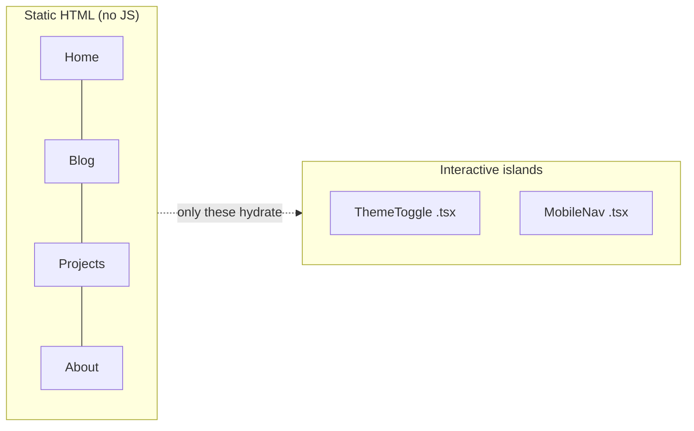

# 01 · Why Astro

> [!abstract] In one line
> Astro is a framework for **sites**: it outputs plain HTML and adds JavaScript
> only to the parts you mark as interactive.

## Mental model

Two families of web framework exist, and they optimise for opposite defaults:

| | Astro | Next.js / Remix / SvelteKit |
|---|---|---|
| Default output | **HTML, zero JS** | an **app runtime** (JS) |
| Add JS by | opting **in** per component | opting **out** (or never) |
| Built for | content, docs, blogs, marketing, portfolios | dashboards, logged-in apps, realtime UIs |
| Mental unit | a **page** | a **component tree** |

The clean way to say it:

> [!quote] Sites vs apps
> Next.js is for **apps** — long-lived, stateful, interactive surfaces.
> Astro is for **sites** — mostly content, occasionally interactive.
> Neither is "better"; they have different defaults.

The nuance: Astro can do SSR and run an app-like backend ([[51-ssg-ssr-hybrid]],
[[52-adapters]]) and Next can build a static blog. The **default** is the
difference — Astro's default ships no JavaScript, and that default is what makes
content sites fast by construction.

## Why "zero JS by default" matters

JavaScript you don't ship can't be slow, can't fail to parse, and can't be
blocked by a flaky network. On this repo's sales pitch, everything is static HTML
except two widgets (the theme toggle and the mobile menu). That's the entire
interactive surface.

## How it works (the one-paragraph version)

You write `.astro` components ([[03-astro-files]]). At build time Astro renders
them to HTML. Components from React/Vue/Svelte can live inside them, but they are
**not** hydrated until you add a `client:*` directive ([[22-hydration-directives]]).
Files in `src/pages/` become routes ([[04-routing]]). Content lives in typed
collections ([[11-content-collections]]). Everything else — SSR, APIs, actions —
is opt-in.

## What Astro gives you out of the box

- **File-based routing** — a file is a URL.
- **Content collections** — markdown with schemas and build-time validation.
- **Islands** — partial hydration of any UI framework.
- **Assets pipeline** — image optimisation via `<Image>` ([[63-images-assets]]).
- **SSR option** — swap the adapter, keep the code.
- **Integrations** — one config line to add Tailwind, sitemap, MDX, etc.
  ([[92-integrations]]).

## Gotchas

> [!warning] "Astro is just a static site generator"
> No. With `output: "server"` and an adapter it renders per-request, runs
> middleware, and serves APIs. Static is the **default**, not the ceiling.

> [!warning] Reaching for an island too early
> The temptation on day one is to make everything an interactive component.
> Resist it. See [[25-when-not-to-hydrate]].

> [!warning] Confusing "no JS" with "no interactivity"
> Astro still gives you full interactivity — you just choose *where* to pay for
> it, instead of paying on every page.

## Exercise

- [ ] Open the repo's `src/pages/index.astro` and list every element that
      **needs** JavaScript. Compare with what actually hydrates in
      `src/components/layout/`.
- [ ] For each island you find, write down which `client:*` directive it uses and
      why that directive (not `client:load`).
- [ ] Name one page in this repo that would be *worse* if built as a Next.js app,
      and one thing in it that would be *better* as a React app. (There may be no
      "better" one — that's the point.)

> [!question]- Why does Astro call its idea "islands"?
> Because the page is a **sea of static HTML** with small interactive **islands**
> in it. The architecture is about making the sea the default and the islands the
> exception. Full treatment in [[21-islands]].

## Further reading
- Astro — *Why Astro?* <https://docs.astro.build/en/concepts/why-astro/>
- Astro — *Islands architecture* <https://docs.astro.build/en/concepts/islands/>

Next: [[02-project-structure]] · Index: [[00-index]]
