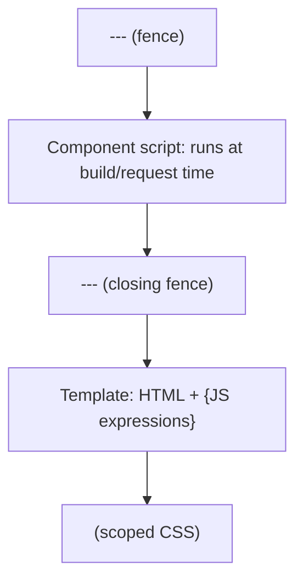

# 03 · `.astro` Files

> [!abstract] In one line
> An `.astro` file has two halves separated by a fence: a **script** that runs on
> the server, and **HTML** that can interpolate values from it.

## Mental model



The script runs **on the server** — at build time for static pages, at request
time for SSR pages. It is *not* shipped to the browser. The template is HTML with
a small expression language on top.

## Anatomy

```astro
---
// 1. Component script — runs on the server, never in the browser.
import Card from "../components/Card.astro"
const { title, items = [] } = Astro.props
const count = items.length
---

<!-- 2. Template — HTML with {expressions} -->
<section>
  <h2>{title}</h2>
  <p>{count} item{count === 1 ? "" : "s"}</p>
  <ul>
    {items.map((item) => <li>{item}</li>)}
  </ul>
</section>

<!-- 3. Optional scoped styles -->
<style>
  section { padding: 1rem; }
</style>
```

## How it works

- **`Astro.props`** — the props passed to the component. Destructure it in the
  script. There's no separate `defineProps`; the shape is inferred from usage, or
  typed explicitly:

  ```astro
  ---
  interface Props { title: string; count?: number }
  const { title, count = 0 } = Astro.props
  ---
  ```

- **Expressions `{…}`** — any JavaScript expression. Use them for text, attributes,
  conditionals (`&&`, ternaries), and `.map()` for lists. No `{if}` — use
  JavaScript.

- **`class:list`** — Astro's helper for conditional classes:

  ```astro
  <a class:list={["btn", active && "btn-active"]}>Link</a>
  ```

- **`set:html`** — inject raw HTML when you must (trusted content only):

  ```astro
  <div set:html={post.body} />
  ```

- **`is:global`** — opt a `<style>` out of scoping:

  ```astro
  <style is:global> :root { --brand: rebeccapurple } </style>
  ```

## The special globals

Inside the script you always have:

| Global | What it is |
|---|---|
| `Astro.props` | props passed in |
| `Astro.url` | the current `URL` |
| `Astro.request` | the `Request` (SSR) |
| `Astro.params` | dynamic route params |
| `Astro.slots` | programmatic slot access |
| `Astro.self` | the component itself (recursion) |
| `import.meta.env` | build-time env (`BASE_URL`, `SITE`, …) |

This repo uses `import.meta.env.BASE_URL` everywhere it builds a link, because
`base` is `/site`:

```astro
---
const base = import.meta.env.BASE_URL
---
<a href={`${base}/blog`}>Blog</a>
```

> [!warning] Never hardcode the base
> `${base}/blog`, not `/blog`. On a GitHub Pages project site the latter 404s.
> Mature repos hide this behind one helper (here: `src/lib/seo.ts`).

## `<style>` is scoped by default

Styles in an `.astro` file get a generated attribute and only apply to elements
in *that* file. That's why component CSS never leaks. (Full story:
[[31-scoped-styles]].)

## Gotchas

> [!warning] The script is not the browser
> `window`, `document`, and `localStorage` don't exist in the fence. If you need
> them, you need a client island ([[21-islands]]) or an inline `<script>` (which
> *is* shipped and runs in the browser).

> [!warning] `---` must be first
> The fence has to open on line 1 and close before any markup. Comments before it
> will break the file.

> [!warning] Expression results are escaped
> `{userInput}` is HTML-escaped. That's a feature. Only use `set:html` for content
> you fully trust.

## Exercise

- [ ] Open `src/pages/index.astro`. Identify: the script half, the template half,
      and any `class:list` or `set:html`.
- [ ] Add a throwaway prop to an existing component and render it with an
      expression. Confirm it appears in the built HTML (`dist/`).
- [ ] Add a `<script>` tag (not the fence) that logs to the console, build, and
      confirm the log appears in the browser — proving the difference between the
      fence and a shipped script.

> [!question]- Why does Astro use two halves instead of a single JS file?
> Because the *point* is to make "this runs on the server" visually obvious. The
> fence is a physical boundary between server work and shipped markup.

## Further reading
- Astro — *Components* <https://docs.astro.build/en/basics/astro-components/>
- Astro — *Expressions & syntax* <https://docs.astro.build/en/reference/astro-syntax/>

Prev: [[02-project-structure]] · Next: [[04-routing]] · Index: [[00-index]]
