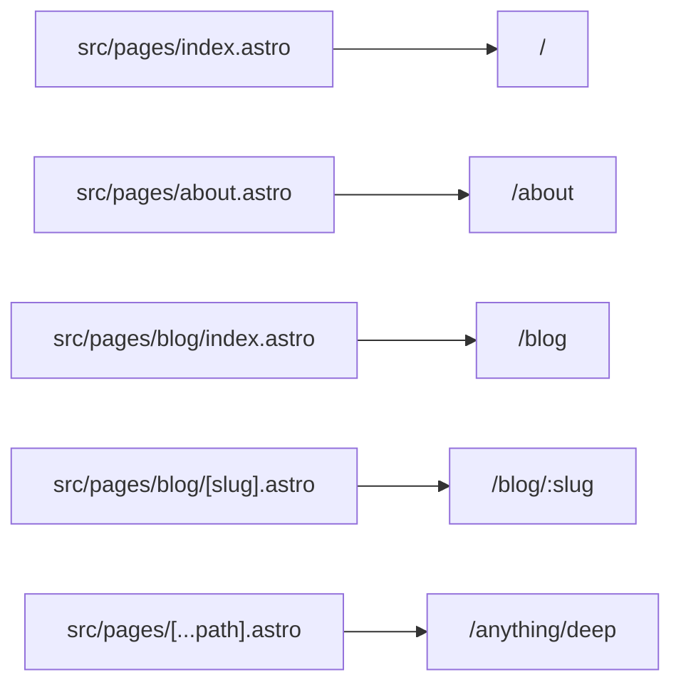

# 04 · Routing

> [!abstract] In one line
> Every file in `src/pages/` becomes a URL; `[brackets]` make a segment dynamic.

## Mental model



The path of the file *is* the route. There's no route table to keep in sync.

## Static routes

```
src/pages/index.astro        → /
src/pages/about.astro        → /about
src/pages/blog/index.astro   → /blog
src/pages/blog/rss.xml.ts    → /blog/rss.xml      (an endpoint, see 41)
```

> [!info] `index.astro` is the directory root
> `blog/index.astro` serves `/blog`; a sibling `blog/[slug].astro` serves one
> level deeper.

## Dynamic routes

A bracketed file handles *many* URLs:

```
src/pages/blog/[slug].astro  → /blog/anything
src/pages/[lang]/about.astro → /en/about, /fr/about
src/pages/[...path].astro    → catch-all, matches nested paths
```

Two flavours of bracket:

| Syntax | Meaning | Example matches |
|---|---|---|
| `[slug]` | one segment | `/blog/hello` → `slug: "hello"` |
| `[...path]` | one **or more** segments | `/a/b/c` → `path: "a/b/c"` |
| `[[id]]` | **optional** segment | `/x` and `/x/1` |

## `getStaticPaths` — for static builds

In a **static** build, Astro can't know your URLs ahead of time, so you enumerate
them. A dynamic route must export `getStaticPaths()` returning
`{ params, props? }` for each page:

```astro
---
import { getCollection } from "astro:content"

export async function getStaticPaths() {
  const posts = await getCollection("blog", ({ data }) => !data.draft)
  return posts.map((post) => ({
    params: { slug: post.id },
    props: { post },          // passed to Astro.props below
  }))
}

const { post } = Astro.props
---
<article><h1>{post.data.title}</h1></article>
```

This repo's `src/pages/blog/[slug].astro` and `projects/[slug].astro` are exactly
this shape.

> [!warning] Missing `getStaticPaths` in a static build
> A dynamic route with no `getStaticPaths` produces **no pages** in a static
> build (and Astro errors). In SSR mode you skip it entirely and read
> `Astro.params` at request time ([[51-ssg-ssr-hybrid]]).

## Priority rules

When two routes could match, Astro prefers, in order:

1. Static (no brackets) routes.
2. Dynamic named routes (`[slug]`).
3. Catch-all (`[...path]`).

So `/blog/about` prefers a literal `blog/about.astro` over `blog/[slug].astro`.

## Accessing params

```astro
---
const { slug, lang } = Astro.params
---
```

In static builds these come from `getStaticPaths`; in SSR they come from the
URL ([[53-middleware]] for validating them).

## Gotchas

> [!warning] Trailing slashes and the base
> With `base: "/site"`, the *file* path is relative to `src/pages/`, but the
> *URL* includes the base. Build links with `import.meta.env.BASE_URL`.
> This repo centralises that in `src/lib/seo.ts`.

> [!warning] Duplicate routes
> `[slug].astro` and `[id].astro` in the same folder both match the same URLs —
> Astro will warn or error. One dynamic segment name per folder.

> [!warning] Case and special characters
> Route filenames map literally. Prefer lowercase, dash-separated names.

## Exercise

- [ ] List every route this repo generates (hint: `bun run build` prints the
      page list; 26 pages).
- [ ] In `src/pages/blog/[slug].astro`, point at the exact lines that (a) build
      the path list and (b) read the matched entry.
- [ ] Add a temporary `src/pages/hello.astro`, build, confirm `/site/hello/`
      exists in `dist/`, then delete it.

> [!question]- Why does static Astro need `getStaticPaths` at all?
> Because static output is frozen HTML written at build time — the framework must
> know *which* URLs to render. `getStaticPaths` is the list. Under SSR there's no
> such problem; you render on demand.

## Further reading
- Astro — *Routing* <https://docs.astro.build/en/guides/routing/>
- Astro — *Endpoints* (later) <https://docs.astro.build/en/guides/endpoints/>

Prev: [[03-astro-files]] · Next: [[05-layouts-and-components]] · Index: [[00-index]]
