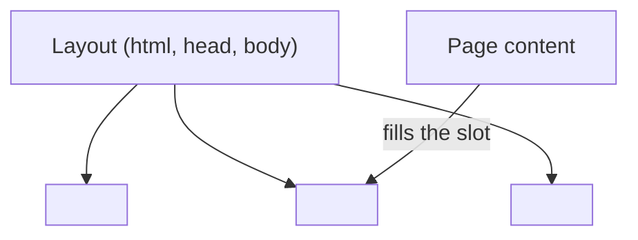

# 05 · Layouts and Components

> [!abstract] In one line
> A layout is just a component that wraps a page; `<slot />` is where the page
> goes.

## Mental model

Components are **functions**; layouts are components that accept a page as their
content. Both are `.astro` files ([[03-astro-files]]). There is no special
"layout" type — only a convention that things in `src/layouts/` render a full
document.



## A minimal layout

```astro
---
// src/layouts/Base.astro
import Header from "../components/Header.astro"
const { title } = Astro.props
---
<!doctype html>
<html lang="en">
  <head><title>{title}</title></head>
  <body>
    <Header />
    <main><slot /></main>
  </body>
</html>
```

A page uses it:

```astro
---
// src/pages/about.astro
import Base from "../layouts/Base.astro"
---
<Base title="About">
  <h1>About</h1>
</Base>
```

Everything between `<Base>…</Base>` lands where `<slot />` sits.

## Named slots

One default slot is the common case, but a component can have more:

```astro
<!-- layout -->
<aside><slot name="sidebar" /></aside>
<article><slot /></article>

<!-- usage -->
<Layout>
  <p>Main content</p>
  <p slot="sidebar">Sidebar</p>
</Layout>
```

## Slots can have fallbacks

```astro
<slot>Shown only when nothing is passed.</slot>
```

If the parent provides children, the fallback disappears.

## Props with defaults

```astro
---
interface Props {
  title: string
  description?: string
}
const { title, description = "" } = Astro.props
---
```

> [!tip] Consistency beats cleverness
> This repo's `src/layouts/main.astro` owns **one** contract: the `<head>`
> (canonical, OG, feed links, theme script, font preloads). Every page goes
> through it, so a meta fix lands everywhere at once. That discipline — "the
> layout owns the document shell" — is the whole reason layouts exist.

## Passing data down vs slotting content up

Two ways to reuse markup:

| Approach | Use when |
|---|---|
| **Props** | the variation is *data* (title, list, flags) |
| **Slots** | the variation is *markup* (a page, a sidebar, a button body) |

Mixing them is normal: props for the header text, a slot for the body.

## Gotchas

> [!warning] A layout that isn't a document
> It's fine to have "nested layouts" (a `PostLayout` inside the `BaseLayout`),
> but only the outermost should render `<html>`/`<head>`/`<body>`. Two documents
> in one page = invalid HTML.

> [!warning] Forgetting the base in layout links
> Layouts are where links live. Use `import.meta.env.BASE_URL` (this repo hides
> it in `src/lib/seo.ts`) or project-site links silently 404.

> [!warning] Slots don't re-render in the browser
> A slot is a build/request-time composition. For interactive content, put an
> island *inside* the slotted markup ([[21-islands]]).

## Exercise

- [ ] Read `src/layouts/main.astro` and list every prop it accepts (look for
      `interface Props`). Match each to a caller in `src/pages/`.
- [ ] Add a `slot name="footer"` (with a fallback) to some layout and pass it
      from one page. Confirm the fallback disappears.
- [ ] Explain why `src/pages/404.astro` can pass `robots="noindex, follow"`
      without writing a `<meta>` itself.

> [!question]- Is a layout a different *kind* of file from a component?
> No. It's a component whose job happens to be rendering the document shell. Astro
> gives it no special powers; the folder name is just self-documentation.

## Further reading
- Astro — *Layouts* <https://docs.astro.build/en/basics/layouts/>
- Astro — *Components & slots* <https://docs.astro.build/en/basics/astro-components/#slots>

Prev: [[04-routing]] · Next: [[06-rendering-model]] · Index: [[00-index]]
