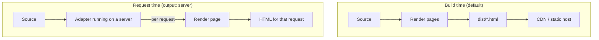

# 06 · The Rendering Model

> [!abstract] In one line
> Astro turns `.astro` files into HTML **at build time** by default, and can move
> that same rendering to **request time** by changing one config line.

## Mental model

There is exactly **one** render step in Astro — the fence in an `.astro` file
runs and produces HTML. The only question is *when* it runs:



Same components. Same syntax. Different clock.

## How it works

- **Static (default).** `astro build` renders every page once and writes frozen
  HTML into `dist/`. Fast, cheap, cacheable, host-anywhere. Dynamic routes need
  `getStaticPaths` ([[04-routing]]).
- **Server.** Set `output: "server"` and add an adapter ([[52-adapters]]).
  Pages render per request, so `Astro.request`, cookies, headers, and secrets are
  all available. Dynamic routes need no `getStaticPaths`.
- **Mixed.** Under `output: "server"` you can opt *individual pages* back into
  static with `export const prerender = true`. That's how you get a mostly-static
  site with a few live endpoints.

```astro
---
// under output: "server", keep this page static
export const prerender = true
---
```

> [!warning] Astro 7 only — `output: "hybrid"` is gone
> Older tutorials say `output: "hybrid"`. In Astro 5+ that mode was merged:
> use `output: "server"` and mark pages `prerender = true` where you want static
> output. Also note `output: "static"` is now the *named* default rather than an
> omission.

## The four phases a request can touch

1. **Routing** — match the URL to a page/endpoint ([[04-routing]]).
2. **Middleware** — run code before the page (`astro:middleware`, [[53-middleware]]).
3. **Rendering** — the component fence executes; layout + page compose.
4. **Response** — HTML (or a stream) goes out; islands' JS is loaded by the
   browser later ([[21-islands]]).

In a static build, phases 1–3 all happen **once, at build time**. Phase 4 happens
millions of times, for free.

## Choosing a mode

| Need | Mode | Reason |
|---|---|---|
| Blog, docs, portfolio, marketing | static | no server, cheapest, fastest |
| Auth, personalisation, live data | server | per-request logic |
| Mostly static + a few API routes | server + `prerender` | best of both |

> [!tip] Start static, move deliberately
> Beginning static keeps you honest: if a feature *needs* a server, you'll feel it
> immediately. Reaching for SSR on day one adds a runtime and a bill for no benefit.

## What "static" does *not* mean

- Not "no JavaScript" — islands still ship JS ([[22-hydration-directives]]).
- Not "no interactivity" — you get all of it, just placed deliberately.
- Not "can't fetch data" — you can fetch at build time from any API ([[42-external-apis]]).

## Gotchas

> [!warning] Build-time `fetch` runs *once*
> A static page that fetches stock prices bakes in the number at build time. If it
> must be live, that page needs SSR — or a client island that fetches.

> [!warning] `prerender` is per page, not per component
> You mark a *page* static. A component doesn't have its own clock; it renders
> whenever its page does.

> [!warning] Secrets in a static build
> There's no request, so no `Astro.request.headers`. Anything you read in the fence
> of a static page becomes public output. Keep private values in SSR routes
> ([[41-endpoints]], [[66-env-config]]).

## Exercise

- [ ] Run `bun run build` and open one file in `dist/`. Confirm it's complete HTML
      with content already in it — not an empty shell awaiting JS.
- [ ] Find every `getStaticPaths` in `src/pages/` and explain, for each, why the
      route can't be literal (it handles many URLs).
- [ ] In `astro.config.mjs`, locate `output` (or its absence). Write one sentence
      explaining why this repo is static.

> [!question]- If static is faster and cheaper, why does SSR exist at all?
> Because some pages can't be known in advance — anything depending on who is
> asking (a session, a cookie, a live feed). SSR is the escape hatch for exactly
> those pages, not a default to reach for.

## Further reading
- Astro — *On-demand rendering* <https://docs.astro.build/en/guides/on-demand-rendering/>
- Astro — *Rendering modes* <https://docs.astro.build/en/basics/rendering-modes/>

Prev: [[05-layouts-and-components]] · Next: [[11-content-collections]] · Index: [[00-index]]
