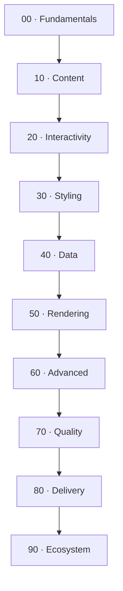

# Astro — Learning Vault

> [!abstract] What this is
> A self-contained, Obsidian-first course that takes you from "I can build a page"
> to "I can build anything Astro supports" — content sites, interactive islands,
> SSR apps, APIs, and deployments. Pinned to **Astro 7.4.0** (installed in the
> repo this vault lives beside).

> [!info] How to read this
> - Notes are numbered inside section folders: `00-fundamentals/`, `10-content/`, …
> - Every note has the same shape: **In one line → Mental model → How it works →
>   Example → Gotchas → Exercise → Further reading**.
> - `level:` in each note's frontmatter is `beginner | intermediate | advanced`.
> - **Do the exercises.** They are small and often use the repo next door.

## The learning path

> [!tip] The one idea behind all of Astro
> **Ship HTML by default; add JavaScript only where a thing is actually
> interactive.** Everything else in Astro is a consequence of that choice.

## Legend
> [!abstract] `abstract` — the single-sentence takeaway
> [!warning] `warning` — a mistake people actually make
> [!example] `example` — code you can run or adapt
> [!question]- `question` — collapsible: click to reveal a "check yourself" answer
> [!quote] `quote` — an opinion or a rule of thumb

## 00 — Fundamentals
- [x] [[01-why-astro]] — sites vs apps, what Astro optimises for
- [x] [[02-project-structure]] — every file and folder, and why it exists
- [x] [[03-astro-files]] — the `.astro` component format, frontmatter, expressions
- [x] [[04-routing]] — file-based routing, dynamic routes, `getStaticPaths`
- [x] [[05-layouts-and-components]] — composition, slots, shared shells
- [x] [[06-rendering-model]] — what happens between `astro build` and a browser

## 10 — Content
- [x] [[11-content-collections]] — typed, queryable markdown
- [x] [[12-content-layer-api]] — `glob`/`file` loaders, remote data
- [x] [[13-markdown-mdx]] — authoring, components in prose
- [x] [[14-schemas-and-validation]] — Zod schemas that fail the build
- [x] [[15-feeds-sitemap-seo]] — RSS, sitemap, meta, structured data

## 20 — Interactivity
- [x] [[21-islands]] — the architecture this whole framework is named after
- [x] [[22-hydration-directives]] — `client:*` and how to choose one
- [x] [[23-framework-integration]] — React (and friends) inside `.astro`
- [x] [[24-props-data-across-boundaries]] — serialising props to an island
- [x] [[25-when-not-to-hydrate]] — the cheapest JavaScript is the JavaScript you don't ship

## 30 — Styling
- [x] [[31-scoped-styles]] — `<style>` in `.astro` and the scoping rule
- [x] [[32-tailwind-v4]] — Tailwind 4 via `@tailwindcss/vite`
- [x] [[33-design-tokens-theming]] — CSS variables, light/dark, one accent
- [x] [[34-code-blocks-expressive-code]] — Expressive Code and theming it

## 40 — Data
- [x] [[41-endpoints]] — API routes and file endpoints
- [x] [[42-external-apis]] — fetch at build time vs request time
- [x] [[43-data-persistence]] — databases, CMS, and the Astro DB story
- [x] [[44-actions]] — type-safe mutations from the client
- [x] [[45-sessions-cookies]] — state across requests

## 50 — Rendering
- [x] [[51-ssg-ssr-hybrid]] — `output`, per-page `prerender`, choosing your model
- [x] [[52-adapters]] — Node, Vercel, Netlify, Cloudflare
- [x] [[53-middleware]] — the request pipeline
- [x] [[54-server-islands-partials]] — `server:defer`, partials, streaming
- [x] [[55-streaming]] — flushing HTML as it becomes ready

## 60 — Advanced
- [x] [[61-view-transitions]] — `ClientRouter`, animated navigation
- [x] [[62-prefetch]] — speculative loading
- [x] [[63-images-assets]] — `Image`, `Picture`, `astro:assets`
- [x] [[64-fonts]] — the experimental/stable Font API and self-hosting
- [x] [[65-i18n]] — routing and content in multiple languages
- [x] [[66-env-config]] — `astro:env` and typed configuration

## 70 — Quality
- [x] [[71-typescript]] — `astro check`, strictness, where types come from
- [x] [[72-testing]] — unit, component, and end-to-end
- [x] [[73-accessibility]] — landmarks, focus, reduced motion
- [x] [[74-performance-budgets]] — Core Web Vitals and what moves them

## 80 — Delivery
- [x] [[81-build-output]] — what `dist/` actually contains
- [x] [[82-hosting-adapters]] — static hosts vs server hosts
- [x] [[83-ci-cd]] — build, check, deploy on every push

## 90 — Ecosystem
- [x] [[91-starlight]] — docs sites without writing a layout system
- [x] [[92-integrations]] — how integrations hook into the build
- [x] [[93-astro-vs-next-vs-sveltekit]] — honest comparison
- [x] [[94-limits]] — where Astro is the wrong tool

## Conventions in this vault
- **Obsidian features used:** callouts, wikilinks, frontmatter properties (incl.
  `tags:`), Mermaid diagrams, task lists, footnotes, and `![[embeds]]`.
- **Not used:** Dataview, queries, or community plugins — these notes must render
  in a **stock** vault.
- **Version pin:** Astro **7.4.0**, Node **>= 22.12**. Anything version-specific is
  flagged with `> [!warning] Astro 7 only`.

> [!question]- Where should I start?
> Start at [[01-why-astro]] and read in order. If you already ship Astro pages,
> skim `00` and start at [[11-content-collections]].
