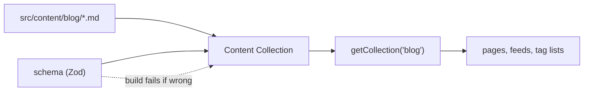

# 11 · Content Collections

> [!abstract] In one line
> A content collection is **markdown with a schema**: typed frontmatter you can
> query, validate at build time, and render.

## Mental model

Loose markdown is just files. A collection is files that Astro has **read,
validated against a schema, and indexed** so pages can query them:



The schema is the whole point: a typo in a date field fails the **build**, not the
visitor's browser.

## How it works

Define collections in **`src/content.config.ts`**, at the `src/` root — not inside
`src/content/`.

```ts
// src/content.config.ts
import { defineCollection } from "astro:content"
import { glob } from "astro/loaders"
import { z } from "zod"

const blog = defineCollection({
  loader: glob({ pattern: "**/*.md", base: "./src/content/blog" }),
  schema: z.object({
    title: z.string(),
    description: z.string(),
    pubDate: z.coerce.date(),
    updatedDate: z.coerce.date().optional(),
    tags: z.array(z.string()).default([]),
    draft: z.boolean().default(false),
  }),
})

export const collections = { blog }
```

This repo's `src/content.config.ts` defines exactly two: `blog` and `projects`.

## Reading content

```astro
---
import { getCollection, getEntry } from "astro:content"

// all entries
const posts = await getCollection("blog")

// filtered
const published = await getCollection("blog", ({ data }) => !data.draft)

// one entry by id
const one = await getEntry("blog", "hello-world")
---
```

Each entry has three parts:

| Part | What it is |
|---|---|
| `entry.id` | the unique key (derived from the filename by the loader) |
| `entry.data` | the **validated** frontmatter |
| `entry.body` | the raw markdown **string** |

## Rendering it

`render()` hands you the compiled component plus extracted headings:

```astro
---
import { getCollection, render } from "astro:content"

const posts = await getCollection("blog", ({ data }) => !data.draft)
const { post } = Astro.props
const { Content, headings } = await render(post)
---
<article><Content /></article>
```

`headings` is `{ depth, slug, text }[]` — that's how this repo builds the "On this
page" table of contents in `src/pages/blog/[slug].astro` (filtering to `depth === 2`).

> [!warning] `id` is not the old `slug`
> With the Content Layer ([[12-content-layer-api]]), `entry.id` comes from the
> **loader** (e.g. the filename via `glob`), and there is no separate `slug`
> frontmatter field required. This repo uses `post.id` as the URL segment in
> `getStaticPaths` — read `id`, not `slug`.

> [!tip] Filtering at the source
> Do `getCollection("blog", ({ data }) => !data.draft)` rather than fetching all and
> filtering later. The callback runs before entries are fully loaded, and it keeps
> the intent in one place. This repo does exactly this in the blog index, the post
> route, and the RSS feed.

## Gotchas

> [!warning] Config file location
> `src/content.config.ts`. A stale `src/content/config.ts` from older tutorials is
> not read in Astro 5+ ([[12-content-layer-api]] covers the move).

> [!warning] Forgetting to export
> A collection not present in `export const collections = { … }` doesn't exist. No
> error until `getCollection` says it can't find it.

> [!warning] Collections aren't routes
> `src/content/` produces **no URLs**. You still need a page (usually
> `[slug].astro`) with `getStaticPaths` to render each entry ([[04-routing]]).

## Exercise

- [ ] Open `src/content.config.ts`. For each field in the `blog` schema, decide
      whether it's required, optional, or defaulted.
- [ ] In `src/pages/blog/[slug].astro`, find the line that filters drafts and the
      line that turns `headings` into a TOC.
- [ ] Add a `readingTime` note: where does `src/lib/text.ts` get the body it
      measures? (It's passed `post.body` — the raw string, not the rendered HTML.)

> [!question]- Why validate content at all when it's your own markdown?
> Because content is data entry, and data entry drifts. A schema turns "the site
> silently rendered `undefined`" into "the build stopped and told you which file".
> The cost is a few lines; the benefit is every future edit.

## Further reading
- Astro — *Content collections* <https://docs.astro.build/en/guides/content-collections/>
- Astro — *`astro:content` reference* <https://docs.astro.build/en/reference/modules/astro-content/>

Prev: [[06-rendering-model]] · Next: [[12-content-layer-api]] · Index: [[00-index]]
