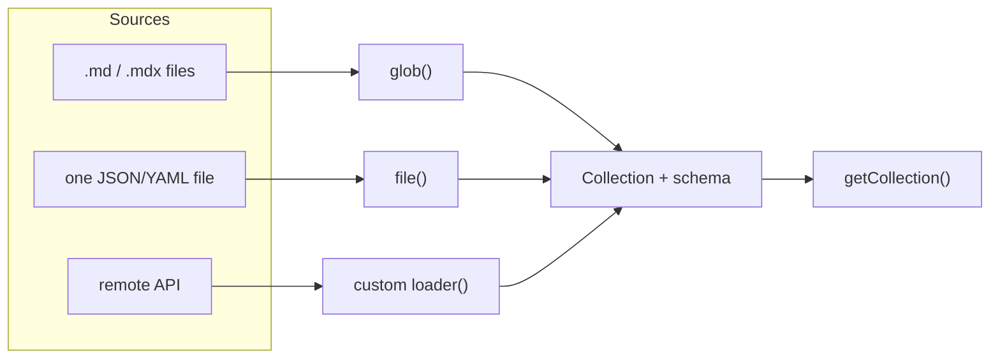

# 12 · The Content Layer API

> [!abstract] In one line
> A **loader** is the thing that puts data into a collection — local files with
> `glob`/`file`, or anything you write yourself.

## Mental model

Before the Content Layer, collections *were* folders of markdown. Now a collection
is defined by **how its entries are loaded**, which decouples the schema from the
source:



## The built-in loaders

**`glob`** — many files matching a pattern:

```ts
import { glob } from "astro/loaders"

const blog = defineCollection({
  loader: glob({ pattern: "**/*.md", base: "./src/content/blog" }),
  schema: /* … */,
})
```

Options worth knowing: `pattern` (glob or array), `base` (folder), and
`generateId` (control how the entry `id` is derived — default is the file path
without extension).

**`file`** — a single JSON or YAML file whose contents become the entries:

```ts
import { file } from "astro/loaders"

const authors = defineCollection({
  loader: file("./src/content/authors.json"),
  schema: z.object({ name: z.string(), url: z.url() }),
})
```

## Custom loaders (fetch anything)

A loader is just an object with a `load` method. It receives a context with a
`store` you write entries into:

```ts
const products = defineCollection({
  loader: {
    name: "products-loader",
    async load({ store, parseData, logger }) {
      const res = await fetch("https://api.example.com/products")
      const items = await res.json()
      for (const item of items) {
        const data = await parseData({ id: String(item.id), data: item })
        store.set({ id: String(item.id), data })
      }
      logger.info(`Loaded ${items.length} products`)
    },
  },
  schema: z.object({ name: z.string(), price: z.number() }),
})
```

This is how you get *remote* data into the same typed, queryable collections —
useful for CMS backends, product catalogues, or generated content
([[42-external-apis]]).

## How entries look once loaded

Regardless of source, entries are uniform: `id`, `data` (validated), and — for
markdown-driven entries — `body`. Rendering still goes through `render()`
([[11-content-collections]]).

## Gotchas

> [!warning] Astro 7 only — the config move
> In Astro 5+, collection definitions live in **`src/content.config.ts`** and use
> loaders. The pre-5 shape (`src/content/config.ts`, implicit folder collections,
> a `slug` field) is gone. Any tutorial that says "put your schema in
> `src/content/config.ts`" is pre-5.

> [!warning] Loader output is cached
> Content is loaded once per build/dev session. In dev, editing a *loader's* input
> (e.g. a remote file) may need a restart; editing markdown invalidates normally.

> [!warning] Custom loaders run in Node
> They can use `fetch`, but not browser globals. Keep secrets in SSR-only code —
> loader output is baked into the build for static sites ([[06-rendering-model]]).

## Exercise

- [ ] Rewrite this repo's `blog` collection mentally for a **remote** source:
      which fields would the loader's `store.set` provide, and which would the
      schema drop or default?
- [ ] What would change if `projects` were a single `file()` loader pointing at
      one `projects.json`? Write the two lines that would differ.
- [ ] Explain why `generateId` matters if two files share a basename in different
      subfolders.

> [!question]- Why separate *loading* from *schema*?
> So the same validation applies to markdown, JSON, and live APIs. You write the
> type contract once and point any source at it — the collection API stays identical.

## Further reading
- Astro — *Content Layer / loaders* <https://docs.astro.build/en/guides/content-collections/#the-content-layer>
- Astro — *Loader reference* <https://docs.astro.build/en/reference/content-loader-reference/>

Prev: [[11-content-collections]] · Next: [[13-markdown-mdx]] · Index: [[00-index]]
