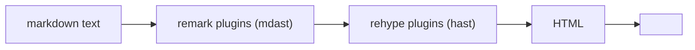

# 13 · Markdown and MDX

> [!abstract] In one line
> Markdown is the default content format; **MDX** is the same thing with
> components allowed inside the prose.

## Mental model

Astro reads markdown through a standard pipeline:



- **remark** works on the markdown AST (before HTML).
- **rehype** works on the HTML AST (after).
- GitHub-Flavored Markdown (tables, task lists, strikethrough, autolinks) is on by
  default.

The pipeline is configurable in `astro.config.mjs` via `markdown` — most people
never need to, because integrations (like Expressive Code, [[34-code-blocks-expressive-code]])
add the plugins for you.

## Markdown in a collection

Files under `src/content/blog/` with frontmatter matching the schema
([[14-schemas-and-validation]]):

```md
---
title: Hello
description: A first post
pubDate: 2026-01-01
tags: [intro]
---

## A heading

Some **bold** text and a [link](https://example.com).
```

The `## A heading` also shows up in `headings` from `render()`, which is how the
TOC is built ([[11-content-collections]]).

## MDX — markdown that can render components

Add the integration:

```js
// astro.config.mjs
import mdx from "@astrojs/mdx"
export default defineConfig({ integrations: [mdx()] })
```

Now `.mdx` files can import and use components inline:

```mdx
---
title: Interactive note
---
import Callout from "../../components/Callout.astro"

<Callout type="tip">MDX lets markup call components.</Callout>

Regular **markdown** still works around it.
```

MDX files are loaded exactly like markdown (a `glob({ pattern: "**/*.{md,mdx}" })`
catches both). `render()` works the same.

> [!warning] MDX components are *static* by default
> A component used in MDX renders at build time like any `.astro` component. For
> interactivity inside prose you still need an island — e.g. a React component
> with `client:visible` used in the MDX ([[22-hydration-directives]]).

## Frontmatter vs body

| Lives in | Becomes | Use for |
|---|---|---|
| frontmatter | `entry.data` (typed) | metadata: title, dates, tags |
| body | `entry.body` (string) + `<Content />` | the actual prose |

> [!tip] Keep metadata out of prose
> Dates, tags, and titles belong in frontmatter so they're queryable and
> validatable. Don't bury a publish date in the first paragraph.

## Gotchas

> [!warning] You can't query MDX imports
> Anything imported *inside* an `.mdx` body is invisible to the collection. If a
> value needs to be sorted or filtered, it must be frontmatter.

> [!warning] Blank lines matter
> Markdown is whitespace-sensitive. A heading glued to a paragraph, or a fence
> missing a blank line before it, renders wrong. When in doubt, add a blank line.

> [!warning] Raw HTML in markdown is allowed — carefully
> You can drop HTML into markdown, but it bypasses markdown parsing inside its
> tags. Prefer components (MDX) over raw HTML blocks.

## Exercise

- [ ] In `src/content/blog/`, find an example that uses a table, a task list, and
      a code fence. Confirm all three survived to `dist/` (open the built page).
- [ ] Explain, in one sentence, why frontmatter `pubDate` is readable from
      `getCollection` but a date written in the prose body is not.
- [ ] If you added the `mdx` integration, which single character would you change
      in `src/content.config.ts`'s `glob` pattern to also load `.mdx`?

> [!question]- When is MDX worth the extra integration?
> When prose needs **components** — interactive demos in a tutorial, callouts,
> live charts. For plain articles, markdown is simpler and has fewer failure modes.
> Reach for MDX when the content is genuinely component-shaped.

## Further reading
- Astro — *Markdown* <https://docs.astro.build/en/guides/markdown-content/>
- Astro — *MDX integration* <https://docs.astro.build/en/guides/integrations-guide/mdx/>

Prev: [[12-content-layer-api]] · Next: [[14-schemas-and-validation]] · Index: [[00-index]]
