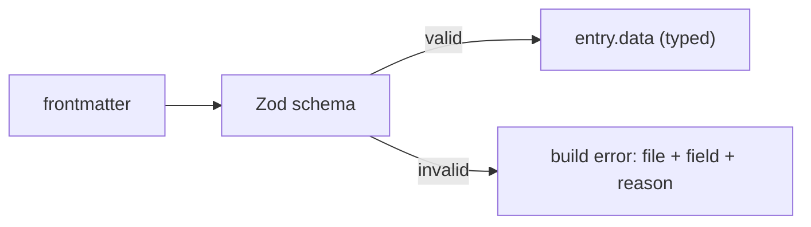

# 14 · Schemas and Validation

> [!abstract] In one line
> A collection schema is a **Zod** object: it describes the frontmatter, and it
> fails the build the moment a file disagrees.

## Mental model



Validation is a **gate**, not a suggestion. Wrong type, missing required field, or
a malformed URL stops `astro build`. You find out at your desk, not from a reader.

## How it works

You can import `z` from `zod` directly (this repo does) or the re-export from
`astro:content`:

```ts
import { defineCollection } from "astro:content"
import { glob } from "astro/loaders"
import { z } from "zod"

const projects = defineCollection({
  loader: glob({ pattern: "**/*.md", base: "./src/content/projects" }),
  schema: z.object({
    title: z.string(),
    description: z.string(),
    pubDate: z.coerce.date(),          // string "2026-01-01" -> Date
    tags: z.array(z.string()).default([]),
    featured: z.boolean().default(false),
    repo: z.url().optional(),
    demo: z.url().optional(),
  }),
})
```

This is literally this repo's `projects` schema.

## The field patterns you'll actually use

| Need | Schema |
|---|---|
| required text | `z.string()` |
| optional text | `z.string().optional()` |
| text with a fallback | `z.string().default("")` |
| a date from a string | `z.coerce.date()` |
| a URL | `z.url()` |
| a fixed set | `z.enum(["draft", "published"])` |
| a list | `z.array(z.string())` |
| a number | `z.number()` |

> [!warning] Astro 7 / Zod 4 — `z.url()`, not `z.string().url()`
> Zod 4 promotes formats to top-level: `z.url()`, `z.email()`, `z.uuid()`. This
> repo's `src/content.config.ts` uses `z.url()` for the `repo`/`demo` fields.
> Older tutorials write `z.string().url()` — still works in many setups, but
> prefer the current form.

## `coerce.date()` and time zones

Frontmatter dates are strings. `z.coerce.date()` runs them through `new Date()`:

```yaml
pubDate: 2026-01-01
```

becomes a real `Date`. Beware: a bare `2026-01-01` is parsed as **UTC midnight**,
so formatting it in a local time zone can show the previous day. This repo avoids
the trap by formatting with `timeZone: "UTC"` in
`src/pages/blog/[slug].astro`. Keep dates and their rendering in the same
time zone and you won't get off-by-one days.

## Referencing another collection

To link entries (e.g. a post's author):

```ts
import { reference } from "astro:content"

author: reference("authors")
```

`reference()` validates that the id exists and gives you a typed link resolved
with `getEntry`/`getEntries`.

## Gotchas

> [!warning] `.default()` vs `.optional()`
> `.optional()` means the field may be `undefined`. `.default(x)` means the field
> is **always present** after parsing (with `x` if omitted). Consumers of `entry.data`
> feel the difference — `.default([])` means you never null-check `tags`.

> [!warning] A schema is strict acceptance, not coercion-by-magic
> `z.number()` rejects `"42"` (a string). If YAML gives you a string, either fix
> the frontmatter or coerce explicitly (`z.coerce.number()`). Don't paper over it.

> [!warning] Errors are per file
> One bad file fails the whole build with a path and field. That's the point — but
> it means a single typo blocks deploys until fixed. Cheap price for guaranteed
> content shape.

## Exercise

- [ ] Add an optional `readingTime` number to the `blog` schema, then decide
      whether it belongs in frontmatter or should be computed (hint: this repo
      computes it from `post.body` in `src/lib/text.ts`).
- [ ] Break a post on purpose: set `pubDate: not-a-date`. Run `bun run build`
      and read the error. Note which file and field it names.
- [ ] Change `tags` from `.default([])` to `.optional()` and find every place
      code would now need a null check. Revert.

> [!question]- Why is build-time failure better than runtime fallback?
> A fallback hides drift: the site "works" but shows a gap. A build failure forces
> the fix before anything ships, and it points at the exact file. Failures you can
> see beat corruption you can't.

## Further reading
- Astro — *Content collections: schemas* <https://docs.astro.build/en/guides/content-collections/#defining-the-collection-schema>
- Zod — *Basic usage* <https://zod.dev/basics>

Prev: [[13-markdown-mdx]] · Next: [[15-feeds-sitemap-seo]] · Index: [[00-index]]
