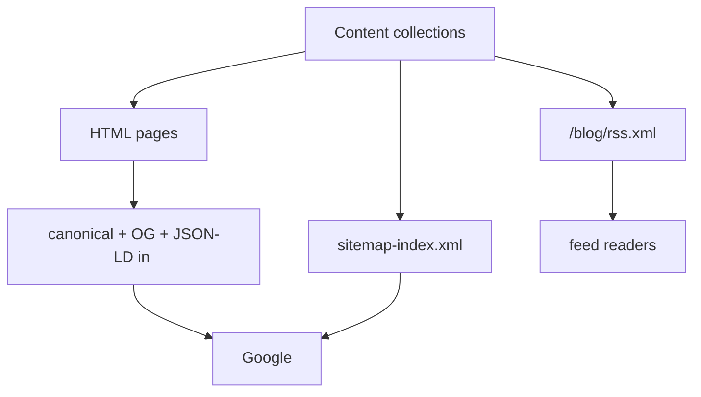

# 15 · Feeds, Sitemap and SEO

> [!abstract] In one line
> RSS, `sitemap.xml`, canonical URLs, and structured data are all just **outputs
> you generate in code** — and one of them (`robots.txt`) is a trap on project sites.

## Mental model

Three kinds of machine-readable output sit beside your HTML:



## RSS — generate the feed yourself

`@astrojs/rss` turns a list of entries into a valid feed. An endpoint (a `.ts` file
exporting `GET`) is the natural place ([[41-endpoints]]):

```ts
// src/pages/blog/rss.xml.ts
import rss from "@astrojs/rss"
import { getCollection, render } from "astro:content"

export async function GET() {
  const posts = await getCollection("blog", ({ data }) => !data.draft)
  const items = posts.map((post) => ({
    title: post.data.title,
    pubDate: post.data.pubDate,
    description: post.data.description,
    link: `/blog/${post.id}/`,
  }))
  return rss({ title: "Blog", site: "https://example.com", items })
}
```

This repo goes further: it renders each post to **full HTML in the feed** using
`experimental_AstroContainer`, so readers don't have to open the site:

```ts
import { experimental_AstroContainer as AstroContainer } from "astro/container"
const container = await AstroContainer.create()
const { Content } = await render(post)
content: await container.renderToString(Content)
```

It also serves the conventional `/rss.xml` by **re-exporting** the blog feed:

```ts
// src/pages/rss.xml.ts
export { GET } from "./blog/rss.xml"
```

> [!warning] Links inside a feed must be absolute
> Feed readers have no page context, so a relative `/blog/x/` link is broken.
> This repo builds them through `src/lib/seo.ts`'s `absolute()` helper, which
> prefixes the `base` (`/site`) and the `site` origin ([[02-project-structure]]).

## Sitemap

The `@astrojs/sitemap` integration needs `site` set and writes
`sitemap-index.xml` at build:

```js
// astro.config.mjs
import sitemap from "@astrojs/sitemap"
export default defineConfig({
  site: "https://ashik-maybe.github.io",
  integrations: [sitemap({ filter: (page) => !page.includes("/tags/") })],
})
```

The `filter` here **excludes tag archives** on purpose — they're thin, near-
duplicate listings, so they're kept out of the sitemap and marked `noindex`.

## Canonical URLs, OG, and JSON-LD

Every page's `<head>` should carry a canonical URL and social metadata. This repo
centralises that in `src/layouts/main.astro` + `src/lib/seo.ts`, with
`absolute()` as the single base-aware URL builder. Structured data (JSON-LD) is
assembled as a graph (`personNode`, `webSiteNode`, `breadcrumbNode`,
`BlogPosting`) and injected with `set:html`.

> [!tip] One URL helper, everywhere
> The single highest-value SEO move in a base-pathed repo is: **never build a URL
> by hand**. Route every absolute URL through `seo.ts` so canonical, OG, JSON-LD,
> RSS, and links can't disagree.

## `robots.txt` — the project-site trap

`robots.txt` only has authority at the **origin root** (`https://host/robots.txt`).
A project site under `/site/` serves `/site/robots.txt`, which crawlers **ignore**.

This repo still emits one (`src/pages/robots.txt.ts`), and documents that it is
**inert on GitHub Pages** rather than pretending it works. The real control is
`noindex` meta on pages you don't want indexed.

> [!warning] Don't rely on `robots.txt` for de-indexing
> `robots.txt` controls *crawling*, not *indexing* — a disallowed URL can still be
> indexed if linked. To keep a page out of search, use
> `<meta name="robots" content="noindex">`. This repo does that for tag archives
> and the 404.

## Gotchas

> [!warning] `site` is required for correct absolute URLs
> Without `site` in config, `astro:build` can't produce correct canonical/sitemap
> URLs and Astro warns. Set it before you care about SEO ([[66-env-config]]).

> [!warning] Feeds and sitemaps are build artifacts
> For a static build they're written once and served like any file
> ([[81-build-output]]). Change content → rebuild → they update.

> [!warning] Beautiful Soup won't save a missing `<h1>`
> Structured data describes a page; it doesn't fix bad content. One `<h1>`, real
> descriptions, and honest metadata do more than any JSON-LD addition.

## Exercise

- [ ] Open `src/pages/blog/rss.xml.ts` and identify the one import that lets it
      render a post to HTML inside the feed.
- [ ] Run `bun run build`, then open `dist/sitemap-index.xml` and confirm no URL
      contains `/tags/`.
- [ ] Explain why `/site/robots.txt` is inert but `/robots.txt` would work — and
      which one a custom domain would fix.

> [!question]- Is SEO part of "content" or "engineering"?
> Both, but in Astro it's mostly engineering: the *content* is honest and typed;
> the *plumbing* (canonical, feed, sitemap, structured data) is generated from the
> same source of truth, so it can't drift.

## Further reading
- Astro — *RSS* <https://docs.astro.build/en/guides/rss/>
- Astro — *Sitemap integration* <https://docs.astro.build/en/guides/integrations-guide/sitemap/>

Prev: [[14-schemas-and-validation]] · Next: [[21-islands]] · Index: [[00-index]]
