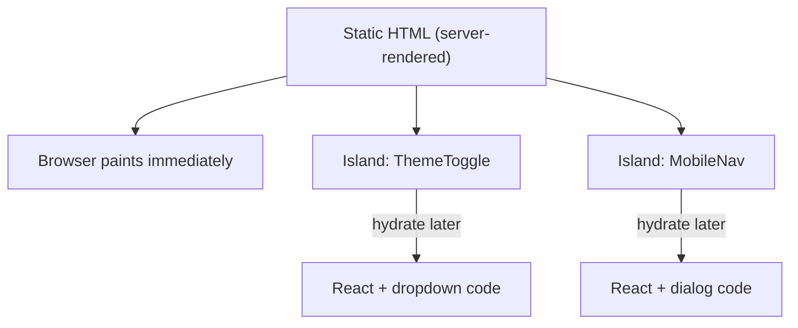

# 21 · Islands

> [!abstract] In one line
> A page is a **sea of static HTML** with a few interactive **islands** — and only
> the islands ship JavaScript.

## Mental model



The HTML is complete and visible before any JavaScript runs. Each island then
"comes alive" independently — its own bundle, its own timing, its own failure
isolation. If one island's JS fails, the rest of the page still works.

## Why this is different from a normal SPA

In Next/Remix/SvelteKit the whole page is a component tree that hydrates as a
unit. In Astro you decide *per component* whether it hydrates at all
([[22-hydration-directives]]).

| | SPA framework | Astro |
|---|---|---|
| What hydrates | the whole app | each island, individually |
| Default JS on a page | all of it | none |
| Adding interactivity | automatic | an explicit `client:*` |

## Islands in this repo

There are exactly **two**, in `src/components/layout/Header.astro`:

```astro
<ThemeToggle client:idle className="size-9" />
<MobileNav client:idle current={current} className="size-9 md:hidden" />
```

Everything else — every page, every `.astro` component — contributes **zero**
JavaScript. That's a 26-page site carrying two widgets' worth of JS.

> [!tip] Islands are ordinary components
> `ThemeToggle.tsx` is just a React component ([[23-framework-integration]]). The
> only thing that makes it an island is the `client:*` directive at the call site.
> Remove the directive and it renders once, to HTML, and never runs again.

## What counts as an island

Only components from a **UI framework integration** (React, Preact, Vue, Svelte,
Solid, Alpine, …) can be islands — because "hydrate" means "run the framework to
attach behavior." A `.astro` component is server-only by nature; a plain `<script>`
in a page is shipped JS but isn't an island (it has no component to hydrate).

## Gotchas

> [!warning] An island isn't a portal
> An island can't directly share React state with another island — they're separate
> roots. Cross-island communication goes through props, the DOM, or a store
> pattern, not shared context ([[24-props-data-across-boundaries]]).

> [!warning] Islands can't wrap the page
> You can't put a layout *inside* an island and expect the page to hydrate. Islands
> are leaves (or small subtrees), not app shells.

> [!warning] Hydration needs the directive *and* a framework component
> `<ThemeToggle />` with no directive = static HTML forever. A `client:*` on an
> `.astro` component = an error/warning. Both halves are required.

## Exercise

- [ ] Count the islands in this repo (grep `client:` under `src/`). Confirm the
      number matches what you expected from [[01-why-astro]].
- [ ] Temporarily remove `client:idle` from `ThemeToggle` and rebuild. Click it —
      it does nothing. Put it back.
- [ ] Name two things on the blog post page that look interactive but are not
      islands (hint: links and the TOC anchors).

> [!question]- Why "islands" and not "partial hydration"?
> They're the same idea; the metaphor is the point. A static ocean with a few
> lively islands is a **default** — most of the page is cold, and that's correct.
> "Partial hydration" describes the technique; "islands" describes the stance.

## Further reading
- Astro — *Islands architecture* <https://docs.astro.build/en/concepts/islands/>
- Astro — *Framework components* <https://docs.astro.build/en/guides/framework-components/>

Prev: [[15-feeds-sitemap-seo]] · Next: [[22-hydration-directives]] · Index: [[00-index]]
