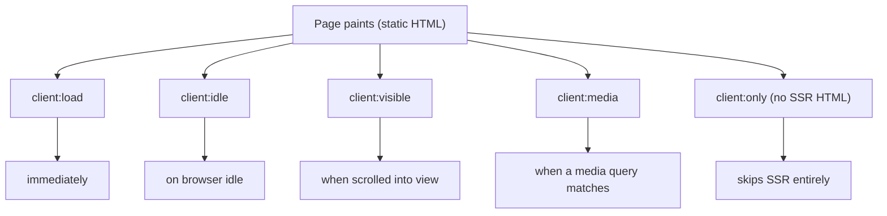

# 22 · Hydration Directives

> [!abstract] In one line
> A `client:*` directive tells Astro **when** to hydrate an island; picking the
> right one is the main performance lever you have.

## Mental model

All directives ship the component's JS and mount it — they differ only in **when**:



## The directives

| Directive | Fires when | Use for |
|---|---|---|
| `client:load` | right away | above-the-fold, must-be-live controls |
| `client:idle` | browser is idle | most UI: menus, toggles |
| `client:visible` | scrolled into view | below-the-fold widgets, embeds |
| `client:media="(…)"` | a media query matches | desktop-only or mobile-only widgets |
| `client:only="react"` | skips SSR, client-renders | components with no meaningful SSR |

This repo uses **`client:idle`** for both islands:

```astro
<ThemeToggle client:idle className="size-9" />
<MobileNav client:idle current={current} className="size-9 md:hidden" />
```

Why `idle` and not `load`? Because neither widget must be interactive the instant
the page paints — the *theme* is already applied by an inline script before paint
([[25-when-not-to-hydrate]]), and the menu can attach a moment later. `idle` keeps
the main thread free for the page itself.

## `client:only` needs the framework name

Because there's no server render, Astro can't infer the renderer from the import
in every case, so you name it:

```astro
<Chart client:only="react" />
```

With `client:only`, the component is **not** in the HTML at all until JS runs — a
blank flash and worse SEO. Reserve it for things that genuinely can't render on
the server (e.g. a canvas or a browser-API-only widget).

## `client:visible` and `client:media`

```astro
<Comments client:visible />            <!-- hydrates on scroll -->
<Sidebar client:media="(min-width: 768px)" />
```

`visible` is the go-to for anything below the fold — it defers the cost until the
user is actually near it.

> [!warning] Astro 7 only — directive set
> Astro ships `client:load`, `client:idle`, `client:visible`, `client:media`, and
> `client:only`. (Older docs mention `client:only` requiring the name; that's still
> true.) There is **no** `client:none` — omitting the directive entirely is how you
> skip hydration.

## Gotchas

> [!warning] Every directive still ships cost
> `client:visible` defers JS, it doesn't remove it. If a widget doesn't need to be
> interactive at all, drop the directive — that's the only way to ship zero JS for
> it ([[25-when-not-to-hydrate]]).

> [!warning] `client:only` breaks SSR-dependent props
> Because it skips server rendering, any data that would have come from the server
> render must arrive another way (props are still serialized, but the initial HTML
> is gone). Prefer server-rendered islands.

> [!warning] Hydration mismatch
> If the server-rendered HTML and the first client render disagree (e.g. you read
> `localStorage` during render), React warns and may flash. Do browser-only work in
> effects — as `ThemeToggle` does.

## Exercise

- [ ] For each of the two islands in this repo, argue why `client:idle` beats
      `client:load`. Then argue when `client:visible` would be better.
- [ ] Change `MobileNav` to `client:visible` and observe: on desktop it's hidden
      (`md:hidden`), so does it ever hydrate? Would `client:media` be more honest?
- [ ] Find one place in the repo where a `client:*` directive would tempt you but
      shouldn't be added, and say why.

> [!question]- If `client:idle` is almost always right, why does `client:load` exist?
> For the rare control that must respond the instant the page is interactive (a
> modal a link deep-links into, a keyboard shortcut handler). Default to `idle`,
> reach for `load` with a reason.

## Further reading
- Astro — *Client directives* <https://docs.astro.build/en/reference/directives-reference/#client-directives>

Prev: [[21-islands]] · Next: [[23-framework-integration]] · Index: [[00-index]]
