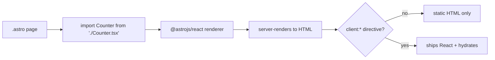

# 23 · Framework Integration

> [!abstract] In one line
> Add one integration and a `.tsx`/`.vue`/`.svelte` file becomes usable inside
> `.astro` — statically by default, hydrating only if you say so.

## Mental model

Astro is a **host**: your UI framework is a **renderer** plugged into it.



The integration teaches Astro how to *render* that framework's components on the
server. The framework runs on the client only for islands ([[22-hydration-directives]]).

## Setup (React)

```js
// astro.config.mjs
import react from "@astrojs/react"
export default defineConfig({ integrations: [react()] })
```

```bash
astro add react     # does the above + installs deps
```

Now:

```astro
---
import ThemeToggle from "@/components/layout/ThemeToggle"
---
<ThemeToggle client:idle className="size-9" />
```

This repo integrates React, which is why exactly two files (`ThemeToggle.tsx`,
`MobileNav.tsx`) are React and everything else is `.astro`.

## Mixing frameworks

You can add several renderers at once — React *and* Vue *and* Svelte — and use
components from each on one page. Each island hydrates with its own runtime; the
runtimes don't share state. Useful when adopting one part at a time.

## Using shadcn/ui-style components

This repo's `src/components/ui/` holds React primitives (button, dropdown-menu,
badge) built in that style. They're imported into the islands like any React
component: a `.tsx` island can use `<Button>` internally, and `.astro` files can
even import a UI component *just for its classes/types* — but interactivity still
needs an island.

> [!tip] React inside, Astro outside
> Prefer keeping framework code **inside islands**. An `.astro` page that imports
> React and hopes for behavior is the classic misunderstanding: without a
> `client:*`, the React never runs.

## `.astro` vs framework components — when to use which

| Use | Component |
|---|---|
| Static layout, page, card, list | `.astro` |
| Needs state, effects, events, refs | framework (`.tsx` …) **+ `client:*`** |
| Shared UI primitive used *inside* islands | framework |

> [!warning] Astro 7 only — React 19
> This repo pairs Astro 7 with React 19. Some shadcn/UI patterns changed with React
> 19 (e.g. `render`-prop composition instead of `asChild`). If a snippet doesn't
> work, check the React version — 18-era component APIs aren't all forward-compatible.

> [!warning] Don't install two renderers for the same framework version range
> Peer-dependency conflicts with React are common. Keep one `react` and one
> `@astrojs/react` pinned together.

## Gotchas

> [!warning] Integrations add work at build time
> Each renderer runs during the build. Adding a framework for one widget is fine;
> adding four "just in case" slows builds and bloats the JS you might ship.

> [!warning] Hooks need a hydrated island
> `useState`/`useEffect` in a component with **no** `client:*` will never run —
> the component rendered once, on the server, and stopped.

> [!warning] Framework CSS is separate from Astro's
> Tailwind 4 and your framework's components coexist, but confirm your styles land
> in the build ([[32-tailwind-v4]]) — a class that only exists in a `.tsx` file
> still has to be seen by Tailwind's scanner.

## Exercise

- [ ] Confirm `react()` is in `astro.config.mjs` and explain what would break in
      `ThemeToggle.tsx` if it were removed.
- [ ] Open `src/components/ui/dropdown-menu.tsx` and trace one class it applies to
      a Tailwind token defined in `src/styles/global.css` ([[33-design-tokens-theming]]).
- [ ] Add a trivial React component with `useState` and **no** directive, render a
      counter, click it. Then add `client:load` and click again.

> [!question]- Why does Astro make you install a renderer instead of auto-detecting?
> Explicitness and build weight. Auto-detection would guess wrong and pull in
> runtimes you didn't choose. One line in config is the price of a lean build.

## Further reading
- Astro — *Framework components* <https://docs.astro.build/en/guides/framework-components/>
- Astro — *React integration* <https://docs.astro.build/en/guides/integrations-guide/react/>

Prev: [[22-hydration-directives]] · Next: [[24-props-data-across-boundaries]] · Index: [[00-index]]
