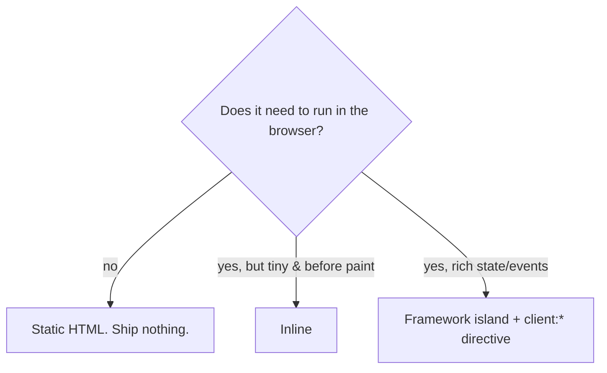

# 25 · When Not to Hydrate

> [!abstract] In one line
> The cheapest JavaScript is the JavaScript you never ship — and the second
> cheapest is a tiny inline script that beats a whole framework to the punch.

## Mental model

Every island is a cost: network, parse, execute, and the risk that it runs *late*.
The art is deciding what must be a hydrated component and what can be plain HTML
or a few lines of inline script.



| Approach | Ships | Use for |
|---|---|---|
| Static HTML | 0 JS | almost everything |
| `<script>` (bundled) | small JS | page-level behavior, progressive enhancement |
| `<script is:inline>` | exact JS, unprocessed | must-run-before-paint, no bundling |
| Island (`client:*`) | framework runtime | genuinely stateful UI |

## The case study: theming without FOUC

Naively, you'd make the theme a React island that reads `localStorage` and adds
`.dark` to `<html>`. That's a mistake: the island hydrates **after** the page
paints, so the user sees a flash of the wrong theme (FOUC) on every load.

This repo does it right. `src/layouts/main.astro` runs a tiny inline script in
`<head>`, **before first paint**:

```html
<script is:inline>
  ;(function () {
    try {
      var stored = localStorage.getItem("theme") || "system"
      var dark = stored === "system"
        ? window.matchMedia("(prefers-color-scheme: dark)").matches
        : stored === "dark"
      var root = document.documentElement
      root.classList.toggle("dark", dark)
      root.style.colorScheme = dark ? "dark" : "light"
      /* …sync the <meta name="theme-color"> to match… */
    } catch (error) {
      /* storage can be unavailable; light is a safe default */
    }
  })()
</script>
```

It sets the class synchronously, so the correct theme is on `<html>` before
anything renders. The React `ThemeToggle` island then does a much smaller job:
**sync the control's UI state** to what's already applied — not paint the theme.

> [!tip] `is:inline` vs a normal `<script>`
> A plain `<script>` is **bundled** (imports resolved, code minified, deferred).
> `is:inline` ships your code **verbatim, in place**. That's exactly what a
> pre-paint, dependency-free snippet needs — it must not wait for a bundle.

## Rules of thumb

1. **Start static.** Add hydration only when something is provably broken without
   it.
2. **Critical-before-paint work belongs in an inline script**, not an island.
3. **Prefer CSS and HTML to JS.** A hover menu, a `<details>` disclosure, a
   `<dialog>` — the platform often already does it.
4. **Pick the latest directive that still works** ([[22-hydration-directives]]):
   `visible`/`idle` over `load`; no directive over any.
5. **One island per need.** Don't merge unrelated widgets just to share a root.

## Gotchas

> [!warning] The flash is a design bug, not an edge case
> FOUC happens on every navigation for every user. If a value must be right at
> first paint (theme, language, auth chrome), it cannot wait for hydration.

> [!warning] `is:inline` scripts can't `import`
> They're not bundled, so no imports and no shared module scope. Keep them small
> and self-contained, wrapped in an IIFE to avoid leaking globals.

> [!warning] Duplicated logic
> The inline script and the island both know about `"theme"`. Keep the storage key
> in one obvious place (here, a constant named `STORAGE_KEY`) and comment the
> contract, or they drift.

> [!warning] Inline scripts and CSP
> A strict `script-src` policy needs a hash/nonce for inline scripts. That's the
> price of pre-paint execution; budget for it if you add CSP ([[83-ci-cd]] aside).

## Exercise

- [ ] In `main.astro`, list everything the inline script does *before* paint, and
      everything `ThemeToggle.tsx` does *after*. Why is the split there?
- [ ] Read the `MutationObserver` in the inline script. What does it keep in sync,
      and why can't CSS alone do it? (The `<meta theme-color>` has no CSS selector.)
- [ ] Find one interactive-looking element in this repo that is **pure CSS/HTML**
      (e.g. `:hover`, `:focus-visible`, `<details>`) and argue it should stay that way.

> [!question]- Isn't inline script "JavaScript too"?
> Yes — but ~15 lines that run once, before paint, versus a framework runtime that
> loads, parses, and mounts later. The inline script is *cheaper and earlier*; it
> wins on both cost and correctness for this job.

## Further reading
- Astro — *Scripts and event handling* <https://docs.astro.build/en/guides/client-side-scripts/>
- web.dev — *Theme flash / FOUC avoidance* <https://web.dev/articles/prefers-color-scheme>

Prev: [[24-props-data-across-boundaries]] · Next: [[31-scoped-styles]] · Index: [[00-index]]
