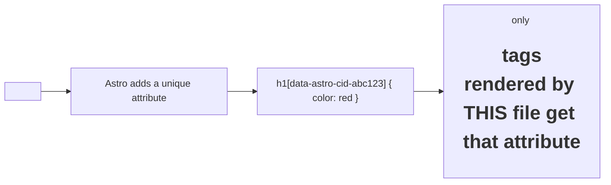

# 31 · Scoped Styles

> [!abstract] In one line
> A `<style>` block in an `.astro` file is **scoped to that file** by default —
> Astro rewrites the selectors so they can't leak.

## Mental model



Two files can both style `h1` with zero conflict, because each gets a different
generated attribute.

## How it works

```astro
---
// Card.astro
---
<article class="card"><slot /></article>

<style>
  .card {
    border: 1px solid var(--border);
    border-radius: 0.625rem;
  }
</style>
```

The `.card` rule only applies to that `<article>`. The class name stays `card` in
the HTML, but the compiled selector carries an extra attribute selector.

> [!tip] This is why component CSS is safe
> You can name a class `.title`, `.wrapper`, `.button` in fifty components and never
> collide. Scoping is the default, so the safe thing is also the easy thing.

## Opting out

**Global styles** — a stylesheet imported once (this repo imports
`src/styles/global.css` in the layout). Anything imported, rather than written in
a `<style>` block, is global.

**`is:global`** — a `<style>` block that should apply everywhere:

```astro
<style is:global>
  :root { --brand: oklch(0.7 0.15 300); }
</style>
```

**`:global(...)`** — escape scoping for one selector:

```astro
<style>
  /* style a child component's element from here */
  .prose :global(h2) { scroll-margin-top: 5rem; }
</style>
```

This repo's global stylesheet uses the scoping escape to style rendered markdown
(the `.prose` output isn't "owned" by the page's `<style>` block).

## Gotchas

> [!warning] Scoped styles can't reach child component internals
> If `Card.astro` renders `<Button>`, your `.card button` selector won't match the
> button's internal markup unless you use `:global()` or style it where it lives.
> That's the cost of isolation — usually a feature.

> [!warning] Dynamic class names evade scoping, not Tailwind
> If you build a class name at runtime (`class={`btn-${variant}`}`), Astro's scope
> attribute still applies, but Tailwind's scanner can't see the string and won't
> generate the utility. Prefer static classes or a lookup map.

> [!warning] `<style>` is per-file, not per-import
> Importing a component doesn't bring its styles into *your* scope — the styles
> stay attached to that component's markup.

## Exercise

- [ ] Build the site and search `dist/` for `data-astro-cid`. Confirm the
      attribute appears on elements and in the compiled CSS selectors.
- [ ] Take a class used in two `.astro` components with different rules and confirm
      they don't fight.
- [ ] In `src/styles/global.css`, find the rule that styles rendered markdown and
      explain why that file is global rather than scoped.

> [!question]- Why scope by default instead of by request?
> Because the common failure in CSS is *accidental* leakage, and the common need is
> "style my own markup." Scoping matches the common case; opting out is explicit
> and rare.

## Further reading
- Astro — *Styles & CSS* <https://docs.astro.build/en/guides/styling/>

Prev: [[25-when-not-to-hydrate]] · Next: [[32-tailwind-v4]] · Index: [[00-index]]
