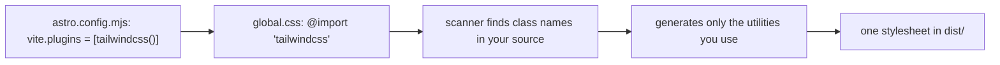

# 32 · Tailwind 4

> [!abstract] In one line
> Tailwind 4 plugs into Astro through **Vite**, not an integration, and is
> configured in **CSS** rather than a JS config file.

## Mental model



Tailwind 4 is a Vite plugin that scans your files and emits utilities on demand.
There is **no `tailwind.config.js`** and no `content: []` array — v4 discovers
sources automatically and you extend the theme *in CSS*.

## How it works

Wire the plugin:

```js
// astro.config.mjs
import tailwindcss from "@tailwindcss/vite"
export default defineConfig({ vite: { plugins: [tailwindcss()] } })
```

Import it in the global stylesheet:

```css
/* src/styles/global.css */
@import "tailwindcss";
@plugin "@tailwindcss/typography";
```

Then use utilities directly on elements:

```astro
<div class="mx-auto max-w-3xl px-4 py-16 sm:px-6">
  <h1 class="text-balance text-3xl font-medium tracking-tight sm:text-4xl">…</h1>
</div>
```

That snippet is this repo's blog post header.

## Extending the theme (in CSS)

v4 replaces the JS `theme.extend` with CSS variables in an `@theme` block:

```css
@theme {
  --color-brand: oklch(0.7 0.15 300);
  --radius-card: 0.625rem;
}
```

Now `bg-brand` and `rounded-card` exist. This repo's `@theme inline` block maps
its token set (background, foreground, primary, …) onto `--color-*`, which is how
`bg-background`/`text-foreground` work ([[33-design-tokens-theming]]).

## Dark mode as a class in v4

Tailwind 4 defaults `dark:` to `prefers-color-scheme`. To drive it from a `.dark`
class instead, define a custom variant:

```css
@custom-variant dark (&:is(.dark *));
```

That single line is why `dark:prose-invert` and friends follow the **manual**
toggle in this repo rather than the OS setting. It's the bridge between Tailwind's
`dark:` utilities and the theme script in the layout ([[25-when-not-to-hydrate]]).

## Gotchas

> [!warning] Astro 7 / Tailwind 4 only
> If a tutorial says "add `@astrojs/tailwind`" or "create `tailwind.config.js`",
> it's Tailwind 3 / Astro 3-era. In v4 you use `@tailwindcss/vite` and CSS-first
> config.

> [!warning] Class detection is textual
> Tailwind's scanner reads files for class-shaped strings. Dynamically composed
> classes (`"text-" + size`) won't be generated. Use full class names, even in
> ternaries — `class:list={[active && "font-medium"]}` is fine because the string
> is literal ([[03-astro-files]]).

> [!warning] `class:list` for conditionals, not `cn()` everywhere
> Astro has its own `class:list` helper. A `cn()` (clsx + tailwind-merge) helper is
> for React components that need to merge/override classes. Use the right tool per
> side of the boundary.

## Exercise

- [ ] In `astro.config.mjs`, confirm Tailwind enters through `vite.plugins`, not
      `integrations`. Explain the difference.
- [ ] In `global.css`, find `@custom-variant dark` and trace one `dark:` utility
      in the repo to it.
- [ ] Add `--color-brand` via `@theme`, use `bg-brand` somewhere, build, and grep
      the output CSS for the generated rule. Revert.

> [!question]- Why move config from JS to CSS?
> Because in v4 the "config" *is* design tokens, and tokens are CSS variables.
> Keeping them in one language removes the JS↔CSS indirection (and the build step
> that translated one into the other).

## Further reading
- Astro — *Tailwind styling* <https://docs.astro.build/en/guides/styling/#tailwind>
- Tailwind — *v4 CSS-first configuration* <https://tailwindcss.com/docs/theme>

Prev: [[31-scoped-styles]] · Next: [[33-design-tokens-theming]] · Index: [[00-index]]
