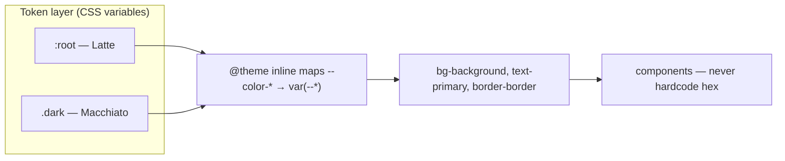

# 33 · Design Tokens and Theming

> [!abstract] In one line
> Define **semantic** variables once per mode, map them into Tailwind, and let
> components speak in roles (`bg-background`) instead of raw colours.

## Mental model



Two layers:
- **Primitive/semantic tokens** — raw values (`--background`, `--primary`), defined
  once for light, once for dark.
- **Utility mapping** — `@theme inline` turns each token into a Tailwind colour
  utility.

## The semantic tokens

```css
/* LIGHT — Catppuccin Latte */
:root {
  --background: oklch(0.985 0.003 264.542); /* #eff1f5 */
  --foreground: oklch(0.445 0.043 279.327); /* #4c4f69 */
  --primary:    oklch(0.555 0.25 297.016);  /* #8839ef */
  --border:     oklch(0.793 0.031 261.468);
  /* … */
}

/* DARK — Catppuccin Macchiato */
.dark {
  --background: oklch(0.279 0.035 276.937); /* #24273a */
  --foreground: oklch(0.871 0.048 273.665); /* #cad3f5 */
  --primary:    oklch(0.772 0.126 303.898); /* #c6a0f6 */
  --border:     oklch(0.426 0.039 276.948);
  /* … */
}
```

Only the **values** change between modes. The *names* are roles, and components
use the role:

```astro
<button class="bg-primary text-primary-foreground">Save</button>
```

That button is correct in both modes with zero conditional logic.

> [!tip] Semantic names are the whole trick
> `--background`/`--foreground`/`--primary` describe **intent**. `--blue-500`
> describes a colour. Components that use intent never need to know which palette
> is active — theme switching becomes "swap variable values," nothing more.

## Mapping into Tailwind

`@theme inline` makes the tokens available as utilities:

```css
@theme inline {
  --color-background: var(--background);
  --color-foreground: var(--foreground);
  --color-primary: var(--primary);
  /* … every role … */
  --radius-lg: var(--radius);
}
```

`--color-background` is what makes `bg-background`/`text-background` exist;
spacing/radius tokens work the same way. This block is also what lets **shadcn/ui**
components ([[23-framework-integration]]) use `bg-card`, `border-border`, etc.,
without knowing your palette.

## Base layer and `@apply`

```css
@layer base {
  * { @apply border-border outline-ring/50; }
  body { @apply bg-background text-foreground; }
  html { @apply font-sans; }
}
```

Two things worth noticing:
- `* { border-border }` — every element's border **colour** defaults to the token,
  so `border` utilities only set width.
- `outline-ring/50` — a consistent focus ring colour, with opacity.

## Accessibility blocks you should copy

```css
@media (prefers-reduced-motion: reduce) {
  *, ::before, ::after {
    animation-duration: 0.01ms !important;
    transition-duration: 0.01ms !important;
    scroll-behavior: auto !important;
  }
}

@media (prefers-reduced-transparency: reduce) {
  .site-header { background-color: var(--background); backdrop-filter: none; }
}

html { scroll-padding-top: 4.5rem; } /* anchors don't hide under the sticky header */
```

These are small, real, and easy to forget ([[73-accessibility]]).

## Gotchas

> [!warning] Don't hardcode a hex in a component
> The moment you write `color: #c6a0f6`, dark mode breaks or the palette can't
> change. Use the token. This is the rule that makes theming cost nothing later.

> [!warning] `@theme` vs `@theme inline`
> `@theme` is for defining new tokens; `inline` mode (as used here) keeps values as
> references to your CSS variables so they follow `:root`/`.dark` at runtime rather
> than being frozen at build time. Getting this wrong is why `dark:` can appear to
> "not work" with custom variables.

> [!warning] Both modes must define every token
> If `.dark` omits a variable, it falls through to the `:root` value (light). Audit
> that the two blocks define the same keys.

> [!warning] `color-scheme` matters beyond CSS
> The theme script also sets `root.style.colorScheme` ([[25-when-not-to-hydrate]]),
> which fixes native form controls and scrollbars. CSS tokens alone don't do that.

## Exercise

- [ ] List every token defined in `:root` and confirm `.dark` defines the same set.
      Note any difference.
- [ ] Trace `bg-primary` end to end: component → `@theme inline` → `:root`/`.dark`.
- [ ] Add a new semantic token (e.g. `--highlight`) in both modes, expose it as
      `--color-highlight`, and use `bg-highlight`. Revert.

> [!question]- Why oklch instead of hex?
> oklch is perceptual: equal lightness steps *look* equal, and it interpolates
> cleanly. The hex is kept in a comment for human reference, but the machine value
> is oklch. Either works; oklch makes colour math predictable.

## Further reading
- Astro — *Styling* <https://docs.astro.build/en/guides/styling/>
- Tailwind — *Theme variables* <https://tailwindcss.com/docs/theme>
- Catppuccin <https://catppuccin.com/palette>

Prev: [[32-tailwind-v4]] · Next: [[34-code-blocks-expressive-code]] · Index: [[00-index]]
