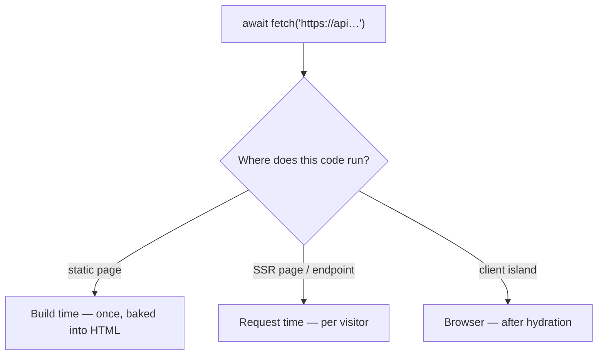

# 42 · External APIs

> [!abstract] In one line
> You `fetch` in the component script — the only question is whether that runs
> **once at build** (static) or **per request** (SSR).

## Mental model



The same `fetch` call has three very different meanings depending on **where it
sits** ([[06-rendering-model]]).

## How it works

Astro supports **top-level `await`** in the fence:

```astro
---
const res = await fetch("https://api.github.com/repos/withastro/astro")
const repo = await res.json()
---
<p>{repo.stargazers_count.toLocaleString()} stars</p>
```

On a static page, that number is frozen at build time. On an SSR page, it's live.

## Choosing the clock

| Data | Where to fetch | Why |
|---|---|---|
| Stable content, docs, catalogue | build time | fastest page, no runtime cost |
| Per-user or rapidly changing | request time (SSR) | must be fresh |
| Depends on scroll/click | client island | interactive, user-driven |
| Many entries into typed collections | content loader | validated + queryable ([[12-content-layer-api]]) |

## Caching and revalidation

Under SSR, Astro exposes route-level caching:

```ts
// in an SSR page/endpoint
Astro.cache.set({ maxAge: 60, tags: ["weather"] })   // cache the response
Astro.cache.invalidate({ tags: ["weather"] })        // purge later
```

The `tags` are accumulated and read via `Astro.cache.tags`, letting you invalidate
a group of routes when underlying data changes. In dev, the cache object exists but
does not cache.

For `fetch` itself, standard web caching applies — pass `cache`/`next`-style hints
managed by your host/adapter, or a `Cache-Control` header on the response.

## Secrets and env

API keys never belong on the client. With SSR, read them from the server
environment:

```ts
import { API_KEY } from "astro:env/server"
const res = await fetch(url, { headers: { Authorization: `Bearer ${API_KEY}` } })
```

`astro:env/server` values are only available to server code ([[66-env-config]]).
A static build bakes whatever it reads into the output — never put a secret there.

## Validating what you get back

Remote APIs lie. Parse defensively with the same tool you use for content schemas:

```ts
import { z } from "zod"

const Repo = z.object({ stargazers_count: z.number() })
const repo = Repo.parse(await res.json())   // throws on shape mismatch
```

Better to fail loudly at build with a clear message than to render `undefined`
([[14-schemas-and-validation]]).

## Gotchas

> [!warning] One flaky API shouldn't break the build
> A static build fetches everything up front. Wrap external calls in `try/catch`
> and decide deliberately: fail the build (correctness) or render a fallback
> (availability). Silent `undefined` is the worst of both.

> [!warning] Watch out for rate limits at build
> 200 pages each calling a rate-limited API = 200 calls per build. Batch, cache the
> response, or move the fetch behind a loader that runs once ([[12-content-layer-api]]).

> [!warning] `fetch` in a `.astro` page isn't a client call
> It runs on the server unless it's inside an island. A React component with
> `client:load` that fetches will fetch in the **browser** — different origin rules,
> different caching, visible URL.

> [!warning] Timeouts and no default
> `fetch` has no default timeout in Node. Add an `AbortSignal.timeout()` if a hung
> API could stall your build.

## Exercise

- [ ] In this repo, find every `fetch`/data read that happens at build time and
      confirm it lands in the generated HTML (no client request needed).
- [ ] Sketch (don't ship) a "GitHub stars" badge for `src/pages/index.astro`.
      Decide: build time or request time? Justify with the table above.
- [ ] Add `zod` parsing to a hypothetical fetch and write the error message you'd
      want a future maintainer to see.

> [!question]- Why is top-level `await` OK here when it's discouraged elsewhere?
> Because the component script isn't a hot path — it runs once per build or once
> per request, and Astro awaits it before rendering. There's no event loop to block.

## Further reading
- Astro — *Data fetching* <https://docs.astro.build/en/guides/data-fetching/>
- Astro — *On-demand rendering / caching* <https://docs.astro.build/en/guides/on-demand-rendering/>

Prev: [[41-endpoints]] · Next: [[43-data-persistence]] · Index: [[00-index]]
