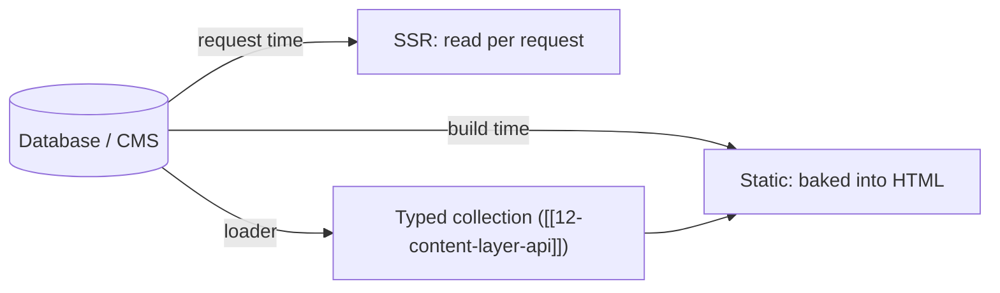

# 43 · Data Persistence

> [!abstract] In one line
> Astro has no built-in database in v7 — persistence is a **normal database or CMS
> you bring yourself**, read at build time (static) or request time (SSR).

## Mental model

Where does stored data *enter* an Astro site?



Three integration points, one rule: **credentials never reach the browser**
([[42-external-apis]]).

## The Astro DB story (read this before following tutorials)

> [!warning] Astro 7 only — there is no `astro:db`
> Older Astro (v4–v5 era) shipped an integrated database reached via
> `import { db } from "astro:db"` and configured with `@astrojs/db`. That is
> **not present in this Astro 7 install** — there's no `astro:db` module and no
> `@astrojs/db` package. If a guide tells you to `astro add db`, treat it as
> version-specific and verify against *your* Astro version before copying it.

## Pick a persistence layer by need

| Need | Reach for | Where it runs |
|---|---|---|
| Handful of records, rarely changes | a JSON/YAML file + `file()` loader | build |
| Content with authors/relations | a headless CMS or git-based CMS | build (or SSR) |
| Relational data, queries, writes | SQLite / Postgres + an ORM | SSR |
| Edge-friendly SQL | D1 / Turso / Neon serverless driver | SSR |

For a **static** site, "persistence" usually means *content source*, loaded once at
build — that's just the Content Layer ([[12-content-layer-api]]). For anything a
user writes back, you need SSR ([[51-ssg-ssr-hybrid]]).

## Minimal example: SQLite behind an endpoint

```ts
// src/pages/api/posts.json.ts  (needs SSR: export const prerender = false)
import Database from "better-sqlite3"
const db = new Database("data/app.db")

export const GET = () => {
  const rows = db.prepare("select id, title from posts order by id desc").all()
  return new Response(JSON.stringify(rows), {
    headers: { "Content-Type": "application/json" },
  })
}
```

For typed queries, an ORM like **Drizzle** wraps the same driver:

```ts
import { drizzle } from "drizzle-orm/better-sqlite3"
import { posts } from "./schema"
const db = drizzle("data/app.db")
const rows = db.select().from(posts).all()
```

The ORM gives you types; Astro doesn't care which one you pick.

## Using a CMS instead

A headless CMS (or a git-based one) is often the right answer for content-heavy
sites: editors get a UI, you get JSON. Two ways in:

1. **Custom loader** — fetch the CMS at build and store entries in a collection
   ([[12-content-layer-api]]). Best for static sites: content is typed and queryable.
2. **SSR fetch** — read at request time for previews or always-fresh content.

## Gotchas

> [!warning] Static + writes = confusion
> A static site can't accept a write. "Database" for a static site means "read-only
> content source at build." If users submit data, that route is SSR by definition.

> [!warning] Don't instantiate a DB client per component
> Create one client at module scope (or a small singleton) so a page with ten
> components doesn't open ten connections.

> [!warning] Secrets and connection strings
> `DATABASE_URL` lives in server env only ([[66-env-config]]). Never import it into
> an island — islands ship to the browser ([[24-props-data-across-boundaries]]).

> [!warning] Migrations are on you
> Astro ships no schema tool now. Use your ORM's migrations (Drizzle Kit, Prisma
> Migrate) and run them in CI/deploy, not at request time.

## Exercise

- [ ] Decide, for three features — a blog, a comment section, a "recently viewed"
      list — which persistence layer and which clock (build vs request) each needs.
- [ ] Explain why the `better-sqlite3` example above must be SSR, using only the
      tables in [[06-rendering-model]].
- [ ] Find one place this repo stores "data" as files (hint: `src/content/`) and
      describe what would change if it moved to a CMS.

> [!question]- Why did Astro drop an integrated database?
> Databases are operationally diverse — file, server, edge, hosted — and every one
> has its own driver, auth, and migration story. Shipping a *generic* SQL layer
> created a lowest-common-denominator that most real apps outgrew. Delegating to the
> ecosystem keeps Astro's core small.

## Further reading
- Astro — *Data fetching* <https://docs.astro.build/en/guides/data-fetching/>
- Drizzle ORM <https://orm.drizzle.team/>
- Turso / D1 / Neon (serverless SQL)

Prev: [[42-external-apis]] · Next: [[44-actions]] · Index: [[00-index]]
