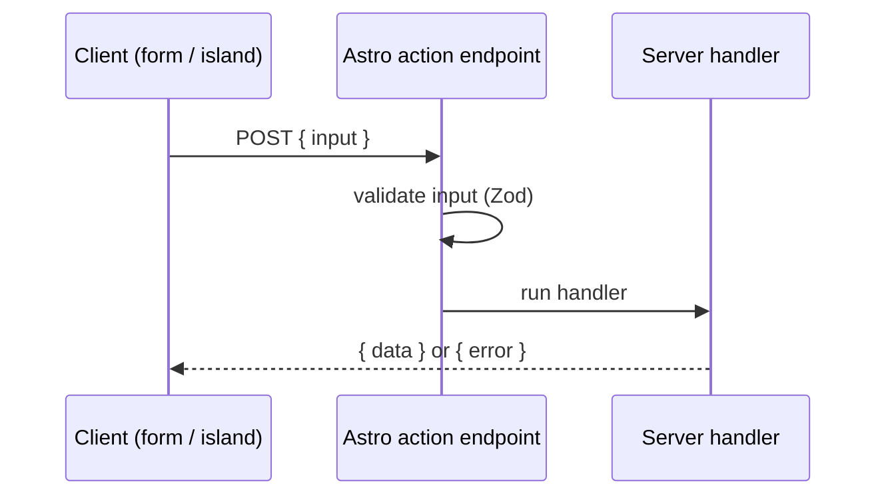

# 44 · Actions

> [!abstract] In one line
> An action is a **type-safe server function** you can call from a form or a client
> island — with the input validated on the server.

## Mental model



Actions live in `src/actions/index.ts` and are addressed by name. The client never
sees your handler — it calls a typed proxy that POSTs to a generated endpoint.

## How it works

Export actions from `src/actions/index.ts` (needs the **SSR** story to run; a
static build can't accept the POST):

```ts
// src/actions/index.ts
import { defineAction, ActionError } from "astro:actions"
import { z } from "zod"

export const server = {
  newsletter: defineAction({
    input: z.object({ email: z.email() }),
    handler: async ({ email }) => {
      if (await alreadySubscribed(email)) {
        throw new ActionError({ code: "CONFLICT", message: "Already subscribed" })
      }
      await save(email)
      return { ok: true }
    },
  }),
}
```

## Calling from an `.astro` form

```astro
---
import { actions, isInputError } from "astro:actions"
const result = Astro.getActionResult(actions.newsletter)
---
<form method="POST" action={actions.newsletter}>
  <input name="email" type="email" required />
  {isInputError(result?.error) && <p>{result.error.fields.email}</p>}
</form>
```

Progressive-enhancement friendly: the form works with plain HTML POST, and the
result comes back typed via `Astro.getActionResult` — no client JS required.

## Calling from an island (client-side)

```tsx
import { actions, isActionError } from "astro:actions"

async function subscribe(email: string) {
  const { data, error } = await actions.newsletter({ email })
  if (isActionError(error)) return { ok: false, message: error.message }
  return data
}
```

And **server-to-server**, without an HTTP hop:

```ts
const result = await Astro.callAction(actions.newsletter, { email })
```

## Validation and errors

- `input` is a Zod schema — invalid input becomes an **input error** with per-field
  messages (`isInputError`).
- Throw `ActionError` for business errors with a code and a safe message.
- Use `isActionError(error)` to narrow the union in clients.

> [!warning] Astro 7 — action imports come from `astro:actions`
> `defineAction`, `actions`, `ActionError`, `isActionError`, and `isInputError` all
> come from `astro:actions`, and the server namespace is the exported `server`
> object. Tutorials targeting other versions sometimes show different import paths
> or a `defineAction`-with-no-args signature; check against your version.

## Gotchas

> [!warning] Actions need a server
> A static build has no request handler. Actions are an SSR feature
> ([[51-ssg-ssr-hybrid]]); using one implies on-demand rendering for that route.

> [!warning] Validate on the server, always
> The `input` schema is not a client-side nicety — it's the trust boundary. Client
> validation is UX; the action's schema is security.

> [!warning] Never trust the client's idea of identity
> An action receives whatever the client sends. Read the session/cookie on the
> **server** to know who is calling ([[45-sessions-cookies]]), not a hidden field.

> [!warning] `isActionError`, `isInputError`, or `{}`
> The return is a `SafeResult` union: `{ data, error: undefined }` on success,
> `{ data: undefined, error }` on failure. Narrow it; don't assume `.data`.

## Exercise

- [ ] Write (in a scratch file) a `feedback` action with `input: z.object({ message: z.string().min(1) })` and explain which error helper the caller uses for a
      missing-message case.
- [ ] Explain why the `.astro` form example works **without** any island, and what
      `Astro.getActionResult` reads.
- [ ] List three things that must be re-checked server-side even if the client
      already validated them.

> [!question]- How is an action different from an endpoint?
> An endpoint is a raw route handler — you hand-roll the request/response contract.
> An action is a **typed RPC**: one schema, one handler, automatic input validation
> and error shape, addressable by name from forms and islands. Use an endpoint for
> resources (feeds, webhooks); use an action for mutations the UI calls.

## Further reading
- Astro — *Actions* <https://docs.astro.build/en/guides/actions/>

Prev: [[43-data-persistence]] · Next: [[45-sessions-cookies]] · Index: [[00-index]]
