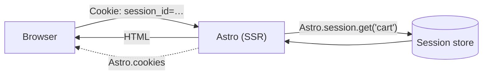

# 45 · Sessions and Cookies

> [!abstract] In one line
> Cookies are small key/values on the request; **sessions** are server-side state
> the cookie points at. Both exist only when you render on demand.

## Mental model



- **`Astro.cookies`** — read/write cookie values yourself.
- **`Astro.session`** — a managed, server-stored object keyed by an opaque cookie.
  The user gets an ID; the *data* stays on the server.

Both require on-demand rendering ([[51-ssg-ssr-hybrid]]): a static page has no
request to read from and no way to set a cookie.

## Cookies

```ts
// SSR page or endpoint
Astro.cookies.set("theme", "dark", {
  httpOnly: true,          // not readable by client JS
  secure: true,            // HTTPS only
  sameSite: "lax",         // CSRF mitigation
  path: "/",
  maxAge: 60 * 60 * 24 * 365,
})

const theme = Astro.cookies.get("theme")?.value
Astro.cookies.delete("theme")
```

> [!warning] Cookie size and count are limited
> ~4 KB per cookie, and few per domain. Store a **key** in the cookie and the data
> in a session/database — never a serialized user object.

## Sessions

Configure storage in `astro.config.mjs` (drivers come from the adapter or `unstorage`):

```js
// astro.config.mjs
import { defineConfig, sessionDrivers } from "astro/config"

export default defineConfig({
  session: {
    driver: sessionDrivers.redis({ url: process.env.REDIS_URL }),
    cookie: { name: "sid", sameSite: "lax", secure: true },
    ttl: 60 * 60 * 24, // seconds
  },
})
```

Then in a page/endpoint/action:

```ts
Astro.session.set("cart", ["sku-1", "sku-2"], { ttl: 3600 })
const cart = await Astro.session.get("cart")
Astro.session.delete("cart")

Astro.session.regenerate()  // new ID, same data — use on privilege change (login)
Astro.session.destroy()     // log out: clears cookie + storage
```

The full surface: `get`, `has`, `keys`, `values`, `entries`, `delete`, `set`,
`regenerate`, `destroy`, `sessionID`, and `load(id)` for restoring by ID.

## Typing session data

Declare the shape in the `App` namespace so `get`/`set` are typed:

```ts
// src/env.d.ts
declare namespace App {
  interface SessionData {
    cart: string[]
    userId?: string
  }
}
```

Now `Astro.session.get("cart")` is `string[] | undefined` with no casts.

## `session: false` (v7.2+)

> [!warning] Astro 7.2+ — opting out
> Since v7.2.0 you can disable sessions entirely with `session: false`. The session
> runtime is then excluded from the SSR bundle and adapters skip wiring a default
> driver — useful on serverless/edge where bundle parse time matters. If you don't
> use `Astro.session`, turn it off.

## Security notes

> [!warning] Sessions are server state — treat the ID as a bearer token
> If the cookie leaks, the session leaks. Set `httpOnly`, `secure`, and `sameSite`;
> rotate with `regenerate()` on login; `destroy()` on logout. Never put the session
> ID in a URL.

> [!warning] Convenience cookies are not identity
> A `userId` cookie the client can edit is not authentication. Trust only what you
> verify server-side (a signed session, a token check).

> [!warning] Adapter-provided defaults
> Some adapters supply a default session driver. Know where your sessions actually
> live (memory = lost on restart, filesystem = per-instance, Redis = shared).

> [!warning] Sessions are per-request only under SSR
> `Astro.session` is `undefined` on a prerendered page. Reading it in a static route
> is a bug in your rendering-mode choice, not a missing import.

## Exercise

- [ ] Sketch a "remember me" box using `Astro.cookies.set` with `maxAge`, and say
      which cookie options are non-negotiable.
- [ ] Explain why `regenerate()` (not `delete` + `set`) is the right move at login.
- [ ] Given a static portfolio site like this repo's, decide whether sessions
      belong on it at all. What would have to change to add a login?
- [ ] Find the `Astro.session` type guard: what does its `| undefined` tell you
      about rendering mode?

> [!question]- Why not just put the cart in a cookie?
> Size, integrity, and privacy. Cookies are ~4 KB, readable/tamperable unless
> signed, and sent on every request. A session ID is tiny, opaque, and keeps the
> data server-side where you control it.

## Further reading
- Astro — *Sessions* <https://docs.astro.build/en/guides/sessions/>
- Astro — *`Astro.cookies`* <https://docs.astro.build/en/reference/api-reference/#cookies>

Prev: [[44-actions]] · Next: [[51-ssg-ssr-hybrid]] · Index: [[00-index]]
