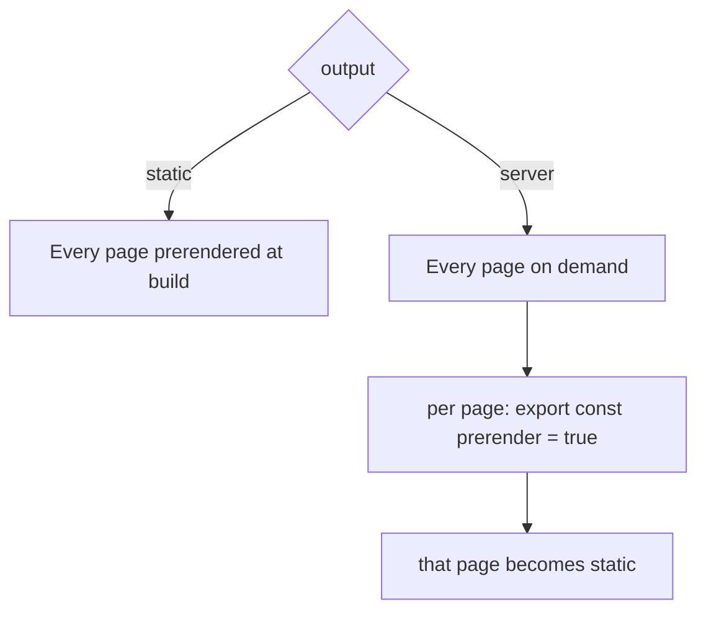

# 51 · SSG, SSR and Mixed Rendering

> [!abstract] In one line
> Choose a **default clock** for the whole site (`output`), then override it
> **per page** (`prerender`).

## Mental model



Two settings, one mental model: a **site-wide default**, a **per-page exception**.
The old third mode (`hybrid`) is gone — it's now `server` + per-page `prerender`
([[06-rendering-model]]).

## How it works

```js
// astro.config.mjs
export default defineConfig({
  output: "server",      // or "static" (the default)
  adapter: node({ mode: "standalone" }), // required for "server"
})
```

Per page (or page-level `.astro`):

```astro
---
export const prerender = true    // force static, even under output: "server"
// export const prerender = false // force on-demand, even under output: "static" (needs adapter)
---
```

## The decision table

| Site shape | Config |
|---|---|
| Blog, docs, portfolio, marketing | `output: "static"` (nothing else) |
| Dashboard, logged-in app | `output: "server"` + adapter |
| Mostly static + a few live routes | `output: "server"` + `prerender = true` on the static ones |
| Static site + one API endpoint | `output: "static"`, give the endpoint `prerender = false` |

> [!warning] Astro 7 only — `hybrid` is gone
> `output: "hybrid"` existed in Astro 3/4. In Astro 5+ it was folded into
> `output: "server"` with per-page `prerender`. `output: "static"` is also the
> explicit name now. If a tutorial mentions hybrid, translate it.

## Features that force on-demand rendering

Anything that needs a **request** forces that route (and the adapter) to be SSR:

- `Astro.request`, headers, `Astro.clientAddress`
- cookies ([[45-sessions-cookies]])
- sessions
- actions ([[44-actions]])
- methods other than `GET` on endpoints ([[41-endpoints]])
- server islands ([[54-server-islands-partials]])

Under `output: "static"` these are unavailable on prerendered pages.

## Response caching (SSR)

On-demand routes can be cached at the route level:

```ts
Astro.cache.set({ maxAge: 300, tags: ["products"] })
Astro.cache.invalidate({ tags: ["products"] })
```

`Astro.cache.tags` reads accumulated tags so you can purge a group. This trades
freshness for cost on exactly the routes that can afford it.

## Gotchas

> [!warning] No adapter, no server
> `output: "server"` without an `adapter` is a config error. Static output needs no
> adapter at all ([[52-adapters]]).

> [!warning] Mixed mode is easy to misread
> A site "mostly static" still needs the adapter installed (because *some* route is
> dynamic). The build still emits HTML for the prerendered pages; the host just
> also runs a server for the rest.

> [!warning] `prerender` lives on pages/endpoints, not components
> You can't make a *component* static or dynamic — only the page it renders in
> decides the clock.

> [!warning] Dev server always pretends it can SSR
> Locally, everything "works" because dev runs a server. The truth surfaces at
> `astro build` — that's why you build before shipping.

## Exercise

- [ ] This repo is static. Name the exact config line (or its absence) that makes
      it so, and what would break first if you switched to `server` without an
      adapter.
- [ ] Take the RSS endpoint and make it on-demand; write the one export you'd add
      and the config change it would require.
- [ ] For each item in "features that force on-demand", name one page in a
      hypothetical app that needs it.

> [!question]- Why a per-page switch instead of a global one?
> Because real sites are mixed: the marketing pages want to be frozen and fast; the
> account page can't be. A per-page flag lets one codebase express both without
> splitting into two projects.

## Further reading
- Astro — *On-demand rendering* <https://docs.astro.build/en/guides/on-demand-rendering/>
- Astro — *Rendering modes* <https://docs.astro.build/en/basics/rendering-modes/>

Prev: [[45-sessions-cookies]] · Next: [[52-adapters]] · Index: [[00-index]]
