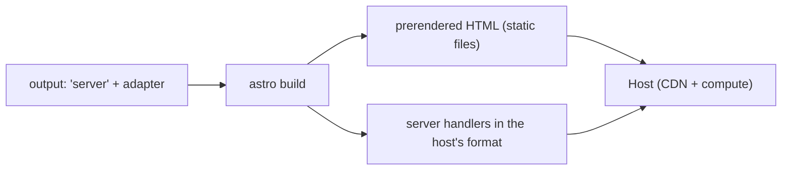

# 52 · Adapters

> [!abstract] In one line
> An adapter teaches Astro how to turn on-demand routes into a specific host's
> serverless functions, edge worker, or Node server.

## Mental model



Without an adapter you only get static files. With one, Astro emits both the static
output **and** a server entry shaped for that platform ([[51-ssg-ssr-hybrid]]).

## How it works

```js
// astro.config.mjs
import node from "@astrojs/node"

export default defineConfig({
  output: "server",
  adapter: node({ mode: "standalone" }),  // or mode: "middleware"
})
```

| Adapter | Target | Notes |
|---|---|---|
| `@astrojs/node` | any Node server | `standalone` (own server) or `middleware` (Express/Fastify) |
| `@astrojs/vercel` | Vercel | functions + edge; image service |
| `@astrojs/netlify` | Netlify Functions / Edge | |
| `@astrojs/cloudflare` | Cloudflare Workers | edge runtime; no Node built-ins |

Install per platform and set `output: "server"` — the adapter is the *only* thing
that knows about the host.

## Static hosts don't need an adapter

GitHub Pages, Netlify static, S3, Cloudflare Pages (static), any CDN: with
`output: "static"` (this repo), you just upload `dist/`. No adapter, no server
([[82-hosting-adapters]]).

## Adapter-specific behaviour

Adapters can supply defaults and services:

- **Session driver** — some adapters wire one automatically ([[45-sessions-cookies]]).
- **Image service** — `@astrojs/vercel` etc. can optimise images at the edge instead
  of at build ([[63-images-assets]]).
- **Platform flags** — `platformProxy` for Cloudflare bindings, `imageConfig`, etc.

> [!warning] Edge ≠ Node
> Cloudflare Workers have no `fs`, no native modules, no long-lived processes.
> Libraries that assume Node (some DB drivers, `better-sqlite3`) won't run there.
> Pick storage accordingly ([[43-data-persistence]]).

## Gotchas

> [!warning] One adapter per config
> You choose *one* deployment target per build. Cross-platform build scripts
> typically swap `astro.config.mjs` (or use env-driven config) rather than install
> two adapters.

> [!warning] Static output ignores the adapter
> If `output` is `"static"`, the adapter does nothing for prerendered pages. Don't
> install one "to be safe" — it changes your build output shape and can add deps.

> [!warning] Version-lock the adapter to Astro
> Adapters track Astro's major. A mismatched `@astrojs/*` version is the usual cause
> of cryptic build failures. Upgrade them together.

## Exercise

- [ ] This repo has no adapter. Confirm the deploy target is "any static host" and
      name one thing you'd gain and one thing you'd lose by adding `@astrojs/node`.
- [ ] For a comments feature (needs writes + sessions), pick an adapter and justify
      it against the edge-warning above.
- [ ] Explain why `output: "static"` + `@astrojs/node` installed is a no-op.

> [!question]- Why is the adapter separate from the framework?
> Because "where it runs" is a deployment choice, not a code choice. Keeping the
> host behind one swappable interface lets the *same* routes target Node, Vercel, or
> Workers — and lets Astro's core stop caring which.

## Further reading
- Astro — *Server islands / adapters* <https://docs.astro.build/en/guides/integrations-guide/#official-integrations>
- Astro — *Deploy to your host* <https://docs.astro.build/en/guides/deploy/>

Prev: [[51-ssg-ssr-hybrid]] · Next: [[53-middleware]] · Index: [[00-index]]
