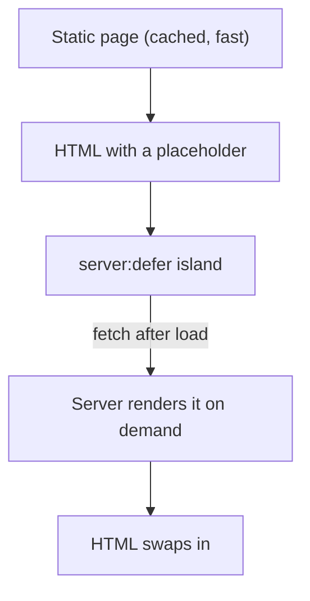

# 54 · Server Islands and Partials

> [!abstract] In one line
> A **server island** keeps one slow, personal, or non-cacheable component dynamic
> inside an otherwise static page; a **partial** returns a bare HTML fragment for
> client-driven updates.

## Mental model



This is the *inverse* of a client island ([[21-islands]]): instead of shipping
framework JS, the browser asks the **server** to render one part later. No hydration,
no framework runtime — just a late fragment.

## Server islands

Mark a component with `server:defer`:

```astro
---
import Avatar from "../components/Avatar.astro"
---
<Avatar server:defer user={Astro.locals.user}>
  <span slot="fallback">Loading…</span>
</Avatar>
```

Requirements: an adapter + on-demand rendering for the containing route
([[51-ssg-ssr-hybrid]], [[52-adapters]]).

What Astro does:
- Renders the page with a **placeholder** where the island goes.
- Encrypts the island's props into the page (that's the `internalProps` set:
  `server:component-path`, `server:component-export`, `server:defer`).
- The browser fetches the island's HTML from a generated endpoint and swaps it in.

Props are encrypted — but still **visible in the request**, so never defer a
component with a secret prop.

> [!warning] Astro 7 — server islands are dynamic by definition
> They need a running server. On pure static output there's nothing to call back to,
> so `server:defer` requires the on-demand story and an adapter.

> [!tip] Server islands vs client islands
> - **Client island (`client:*`)** — you need interactivity; ships framework JS.
> - **Server island (`server:defer`)** — you need freshness/personalisation; ships
>   ~no JS, renders on the server.
> Pick by "does the browser need to *run* it, or just *receive* it?"

## Partials

A **partial** is a page that renders as a fragment (no full document), for
client-driven updates (htmx, fetch-and-swap):

```astro
---
// src/pages/partials/cart.astro
export const partial = true
const items = await getCart(Astro.cookies)
---
<ul>{items.map((i) => <li>{i.name}</li>)}</ul>
```

`partial: true` tells Astro to render just the component output — no `<html>`,
`<head>`, or `<body>` — so a client can inject it into the existing page.

This is the classic AJAX-replacement pattern: server renders HTML fragments, the
client swaps DOM, and you write almost no JavaScript.

## Gotchas

> [!warning] Server islands add a request
> Each deferred island is an extra network round-trip after paint. Use them for
> genuinely slow/personal parts, not for everything — otherwise you've reinvented
> the waterfall you were avoiding.

> [!warning] Fallback content matters
> `<span slot="fallback">` shows while the island loads. Design it (skeletons,
> placeholders) so the page doesn't jump.

> [!warning] Partials aren't for normal navigation
> They exist for *fragment* updates. If a user should get a full page, use a normal
> page — the browser's navigation is better than your fetch-and-swap.

> [!warning] Caching interaction
> Server islands render on demand, so they bypass whatever cached the surrounding
> page. That's the point — but it means their data source must be fast
> ([[42-external-apis]]).

## Exercise

- [ ] Explain, for a logged-in avatar in a cached header, why `server:defer` beats
      `client:load`.
- [ ] Write the `partial: true` export and describe what's *removed* from the
      response compared to a normal page.
- [ ] List two components in a hypothetical dashboard that should be server islands
      and two that should be client islands, with reasons.

> [!question]- Do server islands replace SSR?
> No — they *use* it. They let a mostly-static page keep one dynamic hole without
> making the whole page dynamic. You still need SSR available; you're just applying
> it surgically.

## Further reading
- Astro — *Server islands* <https://docs.astro.build/en/guides/server-islands/>
- Astro — *Partials* <https://docs.astro.build/en/guides/partials/>

Prev: [[53-middleware]] · Next: [[55-streaming]] · Index: [[00-index]]
