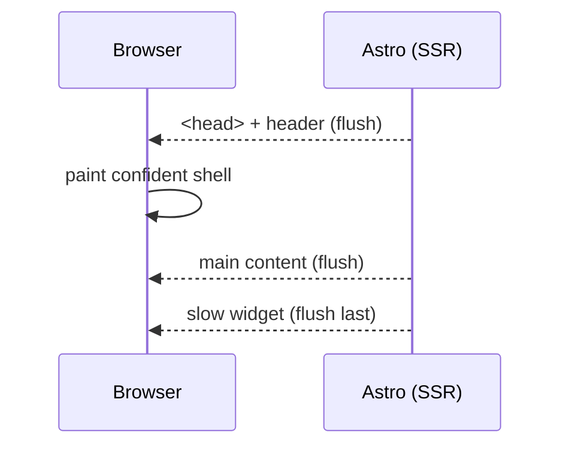

# 55 · Streaming

> [!abstract] In one line
> Under SSR, Astro **streams the HTML** as it renders — the browser can paint the
> header before the slow part of the page is ready.

## Mental model



Instead of building the whole page and sending one blob (Time To First Byte =
total render time), Astro sends bytes as soon as it has them. TTFB drops; the user
sees structure early.

## How it works

Streaming is part of on-demand rendering — you don't opt in with a flag. What you
control is **what goes slow**:

```astro
---
import Slow from "../components/Slow.astro"
---
<header>…</header>
<main>
  <Slow server:defer>            <!-- renders after the shell is flushed -->
    <p slot="fallback">Loading…</p>
  </Slow>
</main>
```

The surrounding HTML flushes first; the deferred island streams in later
([[54-server-islands-partials]]). Astro's runtime uses `renderStreaming` internally
for exactly this.

## What streams well

| Content | Stream it? |
|---|---|
| Header, nav, layout chrome | yes — always first |
| Main text content | yes — fast anyway |
| Personalised/slow widgets | yes — defer behind a boundary |
| SEO-critical content | keep in the initial HTML, not deferred |

> [!warning] Deferred content is not in the first bytes
> Crawlers and `curl` see the shell plus a placeholder first. Anything that must be
> in the initial document (title, article body, meta) should not be deferred.

## Streaming vs islands — don't confuse them

Three different "later"s, each with its own cost:

| Mechanism | Delivers | Ships JS? |
|---|---|---|
| Streaming / `server:defer` | HTML fragment, server-rendered | ~none |
| Client island (`client:*`) | interactivity, hydrated in browser | framework runtime ([[22-hydration-directives]]) |
| Client-side `fetch` in an island | data, from the browser | your fetch code |

Streaming and server islands deliver **HTML**; they don't hydrate. If the deferred
part also needs interactivity, that's a client island on top.

## Gotchas

> [!warning] A streaming response can't change its status/headers late
> Once the first byte (and status) is flushed, you can't turn a `200` into a `500`.
> Validate and set headers **before** you start streaming.

> [!warning] Errors mid-stream are ugly
> If a deferred part throws, the page is already half-sent. Design fallbacks so a
> failure degrades to the fallback slot, not a broken page.

> [!warning] Some hosts/proxies buffer
> A CDN or proxy that buffers the whole response defeats streaming. Confirm your
> host forwards chunks.

> [!warning] Not a free win on static sites
> A prerendered page is already a complete file served from a CDN — there's nothing
> to stream. Streaming matters for **on-demand** routes with slow parts.

## Exercise

- [ ] Measure TTFB on a normal SSR page vs the same page with a `server:defer`
      widget. What changed, and for whom (crawlers vs users)?
- [ ] Decide whether the article body of a blog post should ever be deferred.
      Defend your answer with the crawler caveat.
- [ ] Name one place in a dashboard where streaming the shell early measurably
      helps a slow first load.

> [!question]- Is streaming the same as progressive hydration?
> No. Streaming is about **when bytes arrive**; hydration is about **when
> interactivity attaches**. You can have one without the other — a streamed page
> with no islands is fully static HTML that just arrived in pieces.

## Further reading
- Astro — *Server islands* (deferred rendering) <https://docs.astro.build/en/guides/server-islands/>
- web.dev — *Streaming server rendering* <https://web.dev/articles/rendering-on-the-web>

Prev: [[54-server-islands-partials]] · Next: [[61-view-transitions]] · Index: [[00-index]]
