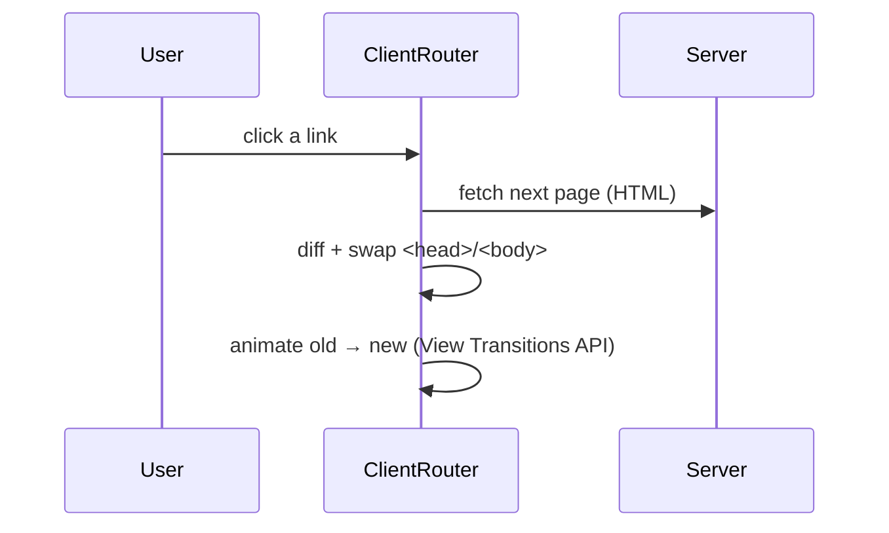

# 61 · View Transitions

> [!abstract] In one line
> Drop `<ClientRouter />` in the `<head>` and Astro can animate between pages using
> the browser's native View Transitions API.

## Mental model



`ClientRouter` turns full page loads into a **client-driven** navigation that keeps
the page alive and animates the swap — without turning your site into an SPA.

## How it works

```astro
---
import { ClientRouter } from "astro:transitions"
---
<head>
  <ClientRouter />
</head>
```

That's the setup. Then optionally name elements to persist or animate:

```astro
        <!-- morphs between pages -->
<video transition:persist src={src} />          <!-- keeps playing across nav -->
<p transition:animate="slide">Animated in.</p>
```

> [!warning] Astro 5+ renamed `ViewTransitions` → `ClientRouter`
> The old `<ViewTransitions />` component still exists as a legacy alias, but new
> code should use `<ClientRouter />` from `astro:transitions`. Tutorials differ here.

> [!tip] Why "client router" and not "SPA"
> It only intercepts navigations; your pages are still server-rendered HTML. If JS
> is off, links behave normally. It's progressive enhancement for navigation.

## What it's good at

- **Persistent chrome** — a playing video or open menu survives navigation
  (`transition:persist`).
- **Cross-page morphs** — `transition:name` on matching elements (e.g. a thumbnail
  that grows into a hero).
- **App-like feel** on multi-page sites without shipping an app framework.

## Gotchas

> [!warning] It ships JavaScript
> `ClientRouter` is a client script on every page it's on. That's fine — but it's
> a *choice*, and on a pure content site it's often unnecessary
> ([[25-when-not-to-hydrate]]).

> [!warning] Scripts must re-run per navigation
> Islands re-hydrate, but plain `<script>` tags don't re-execute on client
> navigation unless you listen for `astro:page-load`. Put page-level setup in an
> `astro:page-load` listener.

> [!warning] Lifecycle events
> `astro:before-preparation`, `astro:after-preparation`, `astro:before-swap`,
> `astro:page-load` — know them before debugging "why did my listener vanish".

> [!warning] Prefetch interplay
> `ClientRouter` and prefetch ([[62-prefetch]]) compose: prefetch warms the next
> page, the router then swaps it in. Together they can make navigation feel instant.

> [!warning] Reduced motion
> Animations should respect `prefers-reduced-motion` ([[73-accessibility]]); this
> repo's global CSS already neutralises transitions under that preference.

## Exercise

- [ ] Decide whether this repo should use `ClientRouter`. Argue both sides with the
      "it ships JS" cost in mind.
- [ ] Sketch `transition:name="post-cover"` on a blog index thumbnail and the post
      page hero — what would the morph look like?
- [ ] Find where you'd add an `astro:page-load` listener for a page-level effect,
      and explain why `DOMContentLoaded` isn't enough.

> [!question]- Does View Transitions require Astro (or a framework)?
> No — it's a browser API. Astro's `ClientRouter` just makes it ergonomic and adds
> smart diffing. You could hand-roll it; you probably shouldn't.

## Further reading
- Astro — *View transitions* <https://docs.astro.build/en/guides/view-transitions/>
- MDN — *View Transition API* <https://developer.mozilla.org/en-US/docs/Web/API/View_Transition_API>

Prev: [[55-streaming]] · Next: [[62-prefetch]] · Index: [[00-index]]
