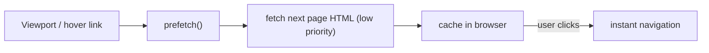

# 62 · Prefetch

> [!abstract] In one line
> Prefetch loads the *next* page in the background when a link is likely to be
> clicked, so navigation feels instant.

## Mental model



You pay a small, idle-time network cost to remove the latency at click time.

## How it works

Enable it globally:

```js
// astro.config.mjs
export default defineConfig({
  prefetch: {
    prefetchAll: true,             // prefetch every link in view
    defaultStrategy: "viewport",   // or "hover" / "tap"
  },
})
```

Or per link:

```astro
<a href="/blog" data-astro-prefetch>Blog</a>
```

Programmatically:

```ts
import { prefetch } from "astro:prefetch"
prefetch("/dashboard")
```

## Strategies

| Strategy | Triggers prefetch when… | Cost |
|---|---|---|
| `hover` | pointer rests on the link | conservative, low waste |
| `tap` | mousedown / touch start | very safe, small head start |
| `viewport` | link scrolls into view | most aggressive, may prefetch a lot |

> [!tip] `hover` is the safe default
> `viewport` on a link-heavy index can prefetch many pages the user never opens.
> `hover` prefetches only what the pointer genuinely targets — good trade-off for
> most sites.

## When it's worth it

- Multi-page navigation the user is *likely* to take (list → detail).
- Sites without `ClientRouter` ([[61-view-transitions]]) that still want snappy
  navigation.
- Slow hosts where the HTML fetch, not render, is the bottleneck.

## Gotchas

> [!warning] Prefetch is bandwidth, not free
> On metered connections or huge pages, prefetching everything is rude. Prefer
> `hover`, or scope to important links.

> [!warning] It respects Save-Data / connection
> Astro's prefetch checks `navigator.connection` hints and skips on data-saver /
> slow connections — but verify on your target browsers, not all support the hint.

> [!warning] Doesn't help client-rendered routes
> Prefetch fetches the HTML document. If a page's content arrives via client fetch
> after load (an island), prefetching the document doesn't prefetch that data.

> [!warning] Prefetch + SSR
> Prefetch issues a real request against your server. On an uncached SSR route,
> speculative prefetch = speculative server cost. Cache those routes.

## Exercise

- [ ] Turn on `prefetch: { defaultStrategy: "hover" }` for this repo (in a scratch
      config) and describe which links it would and wouldn't prefetch.
- [ ] Compare `viewport` vs `hover` on the blog index: estimate how many pages each
      would fetch for a typical visit.
- [ ] Explain why prefetch pairs well with `ClientRouter` but is not required by it.

> [!question]- Isn't prefetch "wasting" requests?
> Sometimes — that's the trade-off. A wasted prefetch is a few KB of idle bandwidth;
> a wasted *click wait* is 100–500ms of perceived latency. Tune the strategy to your
> link density.

## Further reading
- Astro — *Prefetch* <https://docs.astro.build/en/guides/prefetch/>

Prev: [[61-view-transitions]] · Next: [[63-images-assets]] · Index: [[00-index]]
