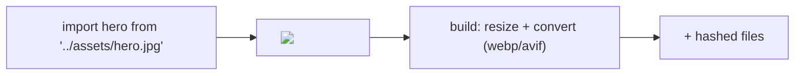

# 63 · Images and Assets

> [!abstract] In one line
> `astro:assets` turns an imported image into an **optimised, responsive**
> ``/`<picture>` — hashed, resized, and format-converted at build time.

## Mental model



Astro reads the source image, generates the sizes it needs, and writes optimised
files with content hashes — then emits the right `` markup.

## Local vs remote

**Local** (in `src/assets/`, statically imported) gets the full treatment:

```astro
---
import { Image } from "astro:assets"
import hero from "../assets/hero.jpg"
---
<Image src={hero} alt="A description" />
```

**Remote** needs the host allowed in config:

```js
// astro.config.mjs
export default defineConfig({
  image: { domains: ["images.example.com"] },
})
```

> [!warning] `public/` images are *not* optimised
> A file in `public/` is copied verbatim and referenced by URL — no hashing, no
> resizing, no format conversion ([[02-project-structure]]). If you want `<Image>`
> to optimise it, the file belongs in `src/assets/`.

## Responsive images

`Image` and `Picture` support responsive props directly:

```astro
<Image
  src={hero}
  alt="Hero"
  layout="constrained"       <!-- or "fixed" / "full-width" -->
  widths={[480, 960, 1440]}  <!-- generate these widths -->
  sizes="(max-width: 640px) 100vw, 640px"
  fit="cover"
/>
```

| Prop | Purpose |
|---|---|
| `layout` | responsive behaviour preset (constrained / fixed / full-width) |
| `widths` / `densities` | candidate sizes for the `srcset` |
| `sizes` | how wide the image renders at each breakpoint |
| `fit` | how to crop when aspect ratios differ |
| `priority` | hint to preload an above-the-fold image |

`Picture` is the same, but lets you offer multiple formats with `<source>` children.
This version also ships `ResponsiveImage` / `ResponsivePicture` components — thin
aliases that forward the same props to `Image` / `Picture`.

## The generated markup

You get roughly:

```html

```

Width/height are set (no layout shift), `srcset` handles density, and the format is
whatever the configured image service produced.

## Choosing an image service

The default service (`sharp`, at build) processes images locally. Hosts can supply
an on-demand service via their adapter ([[52-adapters]]) — e.g. an edge image
service that resizes per request. Set `image.service` to pick one.

## Gotchas

> [!warning] Always write `alt`
> Astro requires it for `Image`. `alt=""` is correct only for purely decorative
> images ([[73-accessibility]]).

> [!warning] Optimising the same image many times is wasted work
> Astro dedupes by source + size, but generating a dozen widths you never use still
> costs build time. Set `widths` to what your layout actually needs.

> [!warning] SVG and animated GIF
> Vector/animated sources aren't rasterised usefully — often better imported as a
> plain URL and used in ``/inline. Don't expect `<Image>` to "optimise" an SVG.

> [!warning] Remote images need explicit dimensions
> For remote sources, pass `width`/`height` (or `inferSize`) so Astro can reserve
> space; otherwise you reintroduce layout shift.

## Exercise

- [ ] In this repo, find one asset in `src/assets/` and one in `public/`. Explain
      why each is where it is.
- [ ] Rewrite a plain `` (if any) as `<Image>` with `widths` and `sizes` for a
      two-column layout.
- [ ] Explain what breaks on a static build if you reference a remote image domain
      you forgot to allow in `image.domains`.

> [!question]- Why build-time optimisation by default?
> Because a static site is built once and served many times. Doing the work once at
> build is cheaper than optimising per request — and the output is just hashed files
> on a CDN ([[81-build-output]]).

## Further reading
- Astro — *Images* <https://docs.astro.build/en/guides/images/>
- Astro — *`<Image>` / `<Picture>` reference* <https://docs.astro.build/en/reference/modules/astro-assets/>

Prev: [[62-prefetch]] · Next: [[64-fonts]] · Index: [[00-index]]
