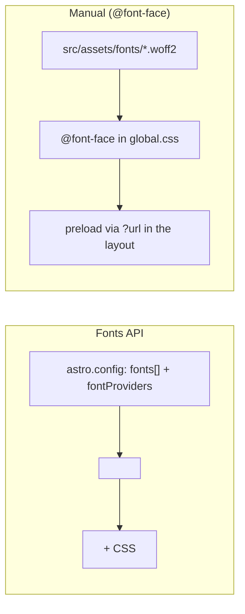

# 64 · Fonts

> [!abstract] In one line
> Astro 7 has a **Fonts API** (declare fonts in config, render `<Font />`), and you
> can always fall back to plain self-hosted `@font-face` — which is what this repo does.

## Mental model



Two routes to the same goal: *fonts that load fast and don't flash*.

## The Fonts API

Declare font families in config, picking a provider:

```js
// astro.config.mjs
import { defineConfig, fontProviders } from "astro/config"

export default defineConfig({
  fonts: [
    {
      provider: fontProviders.google(),
      name: "Inter",
      cssVariable: "--font-inter",
      weights: [100, 900],
      styles: ["normal"],
      subsets: ["latin"],
    },
  ],
})
```

Then render the component in your head:

```astro
---
import { Font } from "astro:assets"
---
<head>
  <Font cssVariable="--font-inter" preload />
</head>
```

`<Font>` injects the `@font-face` rules and (with `preload`) the preload links.The
`cssVariable` is how the rest of your CSS refers to the family.

Providers shipped: `google`, `fontsource`, `local`, `adobe`, `bunny`.

> [!warning] Astro 7 — Fonts API config location
> The `fonts` array is a **top-level** config option in v7 (it was experimental in
> earlier releases). `fontProviders.*` comes from `astro/config`, and `<Font>` from
> `astro:assets`. Check your version before copying older snippets.

## The manual route (this repo's approach)

This template self-hosts variable fonts and declares them by hand — no external
provider, no runtime dependency:

```css
/* src/styles/global.css */
@font-face {
  font-family: "Inter Variable";
  font-style: normal;
  font-display: swap;
  font-weight: 100 900;
  src: url("../assets/fonts/inter-latin-wght-normal.woff2")
    format("woff2-variations");
  unicode-range: U+0000-00FF, …;
}
```

The layout preloads the files via Vite's `?url` import ([[02-project-structure]]):

```astro
---
import interUrl from "@/assets/fonts/inter-latin-wght-normal.woff2?url"
---
<link rel="preload" as="font" type="font/woff2" href={interUrl} crossorigin />
```

Tokens then point utilities at the family:

```css
@theme inline {
  --font-sans: "Inter Variable", sans-serif;
  --font-mono: "JetBrains Mono Variable", ui-monospace, monospace;
}
```

## Why `font-display: swap` and `unicode-range`

- **`swap`** — show fallback text immediately, swap in the web font when ready;
  avoids invisible text (FOIT).
- **`unicode-range`** — only download the subset that covers your characters;
  Latin-only sites skip CJK ranges entirely.

## Gotchas

> [!warning] Preload only what's above the fold
> Preloading every weight/style competes with your CSS and hero image for bandwidth.
> Preload the one or two faces the first paint needs.

> [!warning] `crossorigin` is required on font preloads
> Fonts are fetched in CORS mode; a preload without `crossorigin` is a *second*
> download — worse than no preload.

> [!warning] Variable vs static weights
> A variable font (`wght` axis) covers a weight range in one file — usually smaller
> than shipping several statics. Prefer it when the range is wide.

> [!warning] Don't mix API and manual for the same family
> Pick one mechanism per family, or you'll get duplicate `@font-face` rules and
> double downloads ([[34-code-blocks-expressive-code]] names the mono family explicitly).

## Exercise

- [ ] Trace this repo's Inter font end to end: file → `@font-face` → preload →
      `--font-sans` token → a component that uses it.
- [ ] List the exact `<link>` attributes the manual preload uses and say why
      `crossorigin` is there.
- [ ] Argue for or against migrating this repo to the Fonts API. What would you
      gain (convenience, subsets) and give up (no external calls today)?

> [!question]- Why would you self-host instead of using Google Fonts?
> Privacy (no third-party request), reliability (no external dependency), and
> control (exact subsets, exact caching). It's more setup; the Fonts API narrows
> that gap while keeping the option to self-host via `fontProviders.local()`.

## Further reading
- Astro — *Fonts* <https://docs.astro.build/en/guides/fonts/>
- web.dev — *Optimize web fonts* <https://web.dev/learn/performance/optimize-web-fonts>

Prev: [[63-images-assets]] · Next: [[65-i18n]] · Index: [[00-index]]
