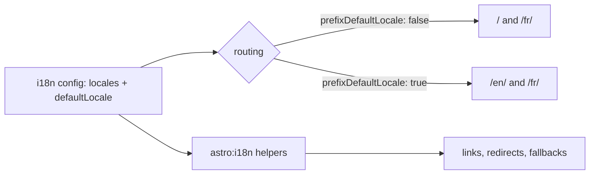

# 65 · Internationalisation

> [!abstract] In one line
> Astro's `i18n` config declares your locales and how URLs look, then gives you
> helpers to build correct links per language.

## Mental model



Two decisions: **which locales** exist, and **how the default one appears in URLs**.

## How it works

```js
// astro.config.mjs
export default defineConfig({
  site: "https://example.com",
  i18n: {
    defaultLocale: "en",
    locales: ["en", "fr", "pt-br", "es"],
    routing: {
      prefixDefaultLocale: false,      // "en" is served at / (no prefix)
      redirectToDefaultLocale: true,   // /  →  /en/ if you prefix instead
    },
    fallback: { fr: "en" },            // missing fr page → render en
  },
})
```

Pages then use a `[lang]` segment:

```
src/pages/index.astro          → /            (default locale)
src/pages/[lang]/index.astro   → /fr/, /es/  (localised)
src/pages/[lang]/about.astro   → /fr/about/
```

Build correct links with helpers from `astro:i18n`:

```astro
---
import { getRelativeLocaleUrl } from "astro:i18n"
const { lang } = Astro.params
---
<a href={getRelativeLocaleUrl("fr", "about")}>À propos</a>
<a href={getRelativeLocaleUrl(lang, "/blog/")}>Blog</a>
```

Variants: `getAbsoluteLocaleUrl` (+ full-origin form) and the `…List` versions that
return every locale's URL for a path (great for hreflang tags).

## Reading the current locale

`Astro.currentLocale` gives the active locale (inferred from the URL/config), so a
layout can set `lang`, date formats, and the language switcher without parsing
params by hand.

```astro
---
const locale = Astro.currentLocale ?? "en"
---
<html lang={locale}>
```

## Domains mode

Instead of path prefixes, you can map locales to **domains**:

```js
i18n: {
  defaultLocale: "en",
  locales: ["en", "fr"],
  domains: { fr: "https://exemple.fr" },
}
```

Useful when a locale deserves its own origin (SEO, ccTLD). The helpers still build
correct absolute URLs.

## Middleware helpers

`astro:i18n` exports middleware utilities: `createMiddleware`, `redirectToDefaultLocale`,
`redirectToFallback`, `notFound`, and `requestHasLocale` — so you don't hand-roll
root redirects or locale detection ([[53-middleware]]).

## Gotchas

> [!warning] Every URL still needs the base
> i18n prefixes and `base` ([[02-project-structure]]) stack. Route all URLs through
> one helper so `/{base}/{lang}/…` is composed in a single place.

> [!warning] Don't translate by string-matching in components
> Read `Astro.currentLocale`, don't infer from `Astro.url.pathname` string surgery.
> The config is the source of truth.

> [!warning] Fallback ≠ translation
> A `fallback` renders the default-locale page at a locale's URL. That's a
> graceful degradation, not a translation — say so in your `hreflang`/meta if it
> matters.

> [!warning] Content collections are separate per locale
> Localised markdown usually needs either per-locale collections or a `lang` field
> in the schema ([[11-content-collections]]) — Astro doesn't auto-translate content.

## Exercise

- [ ] Sketch the file tree for a two-locale site (`en` default at root, `fr`
      prefixed). Which pages need a `[lang]` segment?
- [ ] Write the `<link rel="alternate" hreflang>` tags for one page using a
      `getAbsoluteLocaleUrlList` call.
- [ ] Decide: for this repo (a personal portfolio), which of `prefixDefaultLocale`
      true/false reads best in the URL bar, and why.

> [!question]- Why make locale part of the *route* instead of a cookie?
> Because URLs are shareable, indexable, and cacheable. A locale in a cookie means
> two users with different languages get the same URL — which breaks CDNs and SEO.
> The path/domain is the honest place for language.

## Further reading
- Astro — *Internationalization* <https://docs.astro.build/en/guides/internationalization/>

Prev: [[64-fonts]] · Next: [[66-env-config]] · Index: [[00-index]]
