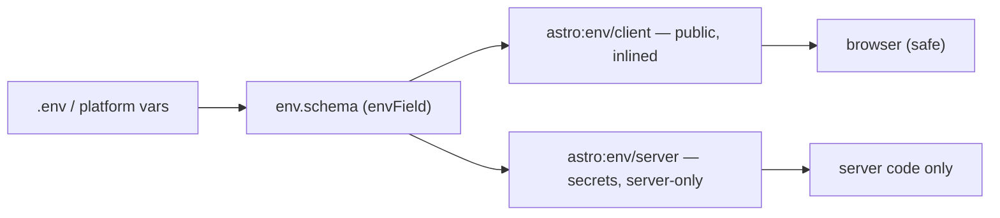

# 66 · Environment and Config

> [!abstract] In one line
> `astro:env` makes environment variables **typed and validated**: `client` values
> are public, `server` values are secret-only.

## Mental model



The schema is the boundary between what the browser may see and what it must not.

## How it works

Declare variables in config:

```js
// astro.config.mjs
import { defineConfig, envField } from "astro/config"

export default defineConfig({
  env: {
    schema: {
      PUBLIC_SITE_URL: envField.string({ context: "client", access: "public" }),
      API_KEY: envField.string({ context: "server", access: "secret" }),
      ENABLE_BANNER: envField.boolean({ context: "client", access: "public", default: false }),
    },
  },
})
```

Field types: `envField.string`, `envField.number`, `envField.boolean`,
`envField.enum`.

Read them from the matching module:

```ts
import { PUBLIC_SITE_URL } from "astro:env/client"     // safe in islands too
import { API_KEY } from "astro:env/server"             // server code only
```

Using a `context: "server"` value in client code is an **error** — the whole point.

## Why not just `import.meta.env`?

You can still use `import.meta.env` for Vite-style variables (`BASE_URL`, `SITE`),
but `astro:env` adds:

| Feature | `import.meta.env` | `astro:env` |
|---|---|---|
| type | loose (`string \| undefined`) | typed per field |
| validation | none | fail-fast on missing/malformed |
| client/server split | manual (`PUBLIC_` prefix) | enforced by `context` |
| secrets | easy to leak | `access: "secret"` |

> [!tip] This repo's pattern
> `import.meta.env.BASE_URL` is used everywhere for base-prefixed links because it's
> built-in and static. `astro:env` is the tool for *your own* values with real
> validation ([[02-project-structure]], [[15-feeds-sitemap-seo]]).

## Static vs SSR

- **Static build:** client values are inlined into the HTML/JS; server values are
  available at build time only. There is no request, so "server secret" means "used
  during build, then baked."
- **SSR:** server values are read at request time and never reach the browser bundle.

> [!warning] Static + secret = baked output
> In a static build, a `server` secret used to render a page ends up in that page's
> output. Secrets are for **SSR** routes ([[41-endpoints]], [[45-sessions-cookies]]).

## Gotchas

> [!warning] `access: "secret"` can't be imported client-side
> That's enforced, and it's the feature. If you "need" it in an island, you actually
> need a server endpoint or an action ([[44-actions]]) to broker it.

> [!warning] Don't ship a map of your secrets
> `context: "client", access: "public"` is inlined into the browser. Only put
> genuinely public values there (analytics IDs, public URLs).

> [!warning] `.env` is for local dev
> Production values come from the host's env settings. Keep `.env` out of git and
> set real values per environment in CI/deploy ([[83-ci-cd]]).

> [!warning] Validation happens at build/start
> A missing required var fails fast — good — but that means a deploy can fail on a
> missing variable. That's better than a runtime `undefined` deep in a page.

## Exercise

- [ ] Add (in a scratch config) a `PUBLIC_ANALYTICS_ID` client field and an
      `API_KEY` server secret, then note which module each is imported from.
- [ ] Explain why the email/Discord placeholders in this repo's `src/config.ts` are
      regular config values, not `astro:env` secrets.
- [ ] Given a static portfolio, name the only kind of value that would justify an
      `astro:env` field here.

> [!question]- Why a schema instead of just reading `process.env`?
> Because `process.env` is an untyped string bag that fails silently. A schema turns
> environment configuration into a checked contract: named, typed, validated, and
> with an enforced public/secret boundary.

## Further reading
- Astro — *Environment variables* <https://docs.astro.build/en/guides/environment-variables/>
- Astro — *`astro:env` reference* <https://docs.astro.build/en/reference/modules/astro-env/>

Prev: [[65-i18n]] · Next: [[71-typescript]] · Index: [[00-index]]
