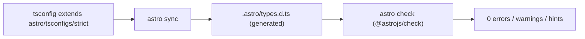

# 71 · TypeScript

> [!abstract] In one line
> Astro type-checks `.astro` files too — via `astro check`, the generated
> `.astro/types.d.ts`, and a `tsconfig` that extends an Astro preset.

## Mental model



`tsc` alone doesn't understand `.astro`. `astro check` wraps the Astro language
server so template expressions, props, and content types are all verified.

## How it works

```json
// tsconfig.json
{
  "extends": "astro/tsconfigs/strict",
  "include": [".astro/types.d.ts", "**/*"],
  "exclude": ["dist"],
  "compilerOptions": {
    "jsx": "react-jsx",
    "jsxImportSource": "react",
    "paths": { "@/*": ["./src/*"] }
  }
}
```

- **`astro/tsconfigs/{base,strict,strictest}`** — escalating presets. `strict` is
  the sane default; `strictest` adds the last bits of rigor.
- **`.astro/types.d.ts`** — generated by `astro sync` (run automatically by
  `dev`/`build`/`check`). It's where `astro:content`, `astro:env`, and friends get
  their types. Never edit it; don't commit assumptions about its shape.
- **`@/*`** — a path alias to `src/`, so imports read `@/components/…` instead of
  `../../../components/…`.

Run it:

```bash
astro check      # this repo: bun run typecheck
```

## Typing props

```astro
---
interface Props {
  title: string
  count?: number
}
const { title, count = 0 } = Astro.props
---
```

The `Props` interface *is* the contract: callers get errors on missing/wrong props,
and the script gets inference for free. For a component that forwards another's
props, use the helper:

```ts
import type { ComponentProps } from "astro/types"
type ButtonProps = ComponentProps<typeof Button>
```

## Where types come from

| Type | Source |
|---|---|
| content entries | schema in `src/content.config.ts` ([[14-schemas-and-validation]]) |
| `Astro.locals` | `declare namespace App { interface Locals … }` ([[53-middleware]]) |
| `App.SessionData` | same namespace ([[45-sessions-cookies]]) |
| env vars | `env.schema` ([[66-env-config]]) |
| `astro:*` modules | `.astro/types.d.ts` (generated) |

## Gotchas

> [!warning] Don't hand-write declarations for generated modules
> If `astro:content` "isn't typed", run `astro sync` — don't stub it. The types are
> generated from *your* schema and config.

> [!warning] `any` from untyped props
> Destructuring `Astro.props` with no `Props` interface gives `any`. That can hide
> real bugs. Type the interface.

> [!warning] `astro check` ≠ `tsc`
> Plain `tsc --noEmit` will miss everything inside `.astro` templates. Use
> `astro check` in CI ([[83-ci-cd]]) so a broken template fails the build.

> [!warning] TS 6 / Zod 4 (this repo)
> This template pins TypeScript `~6.0` and Zod `^4` (hence `z.url()` in the content
> schema, [[14-schemas-and-validation]]). Older snippets may assume TS 5 / Zod 3
> signatures — check before pasting.

## Exercise

- [ ] Run `bun run typecheck` and confirm 0 errors/warnings/hints, then introduce a
      deliberate prop type error and see `astro check` catch it.
- [ ] Find where `@/` is defined and rewrite one relative import to use it.
- [ ] Open `.astro/types.d.ts` (after a build) and locate the generated types for
      one of your content collections.

> [!question]- Why does `.astro` need its own checker?
> Because a `.astro` file is neither TS nor HTML — it's a template with a
> server-side script. Only a checker that understands the format can type the
> boundary between the two halves ([[03-astro-files]]).

## Further reading
- Astro — *TypeScript* <https://docs.astro.build/en/guides/typescript/>
- Astro — *`astro check`* <https://docs.astro.build/en/reference/cli-reference/#astro-check>

Prev: [[66-env-config]] · Next: [[72-testing]] · Index: [[00-index]]
