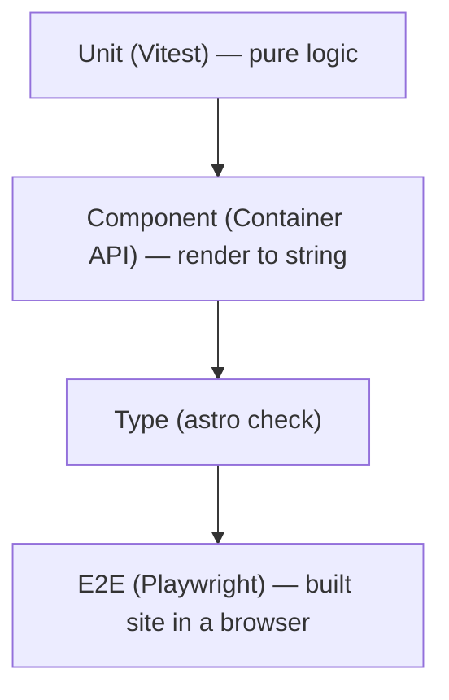

# 72 · Testing

> [!abstract] In one line
> Test in layers: pure functions with Vitest, components with the **Container API**,
> and rendered pages with Playwright — plus `astro check` as a gate.

## Mental model



Each layer is cheaper and faster than the one below. Push assertions as far *up*
this list as they'll legitimately go.

> [!warning] This template ships **no** test runner
> Its verification is `bun run build` (26 pages) + `bunx astro check` (0/0/0), per
> `AGENTS.md`. That's a deliberate minimal choice. This note shows how you'd *add*
> tests — it doesn't claim the repo has them.

## Layer 1 — unit tests (Vitest)

Pure helpers are the easiest wins. This repo has `src/lib/text.ts` (`readingTime`,
`slugifyTag`) — perfect unit targets:

```ts
// src/lib/text.test.ts
import { expect, test } from "vitest"
import { readingTime, slugifyTag } from "./text"

test("readingTime counts words", () => {
  expect(readingTime("one two three")).toBeGreaterThan(0)
})

test("slugifyTag lowercases and dashes", () => {
  expect(slugifyTag("Machine Learning")).toBe("machine-learning")
})
```

```bash
npm i -D vitest
npx vitest run
```

## Layer 2 — component tests (Container API)

Astro can render a component to an HTML **string** without a browser, via the
Container API (`astro/container`). This is exactly what this repo's RSS route uses
to inline post HTML ([[15-feeds-sitemap-seo]]):

```ts
import { experimental_AstroContainer as AstroContainer } from "astro/container"
import Badge from "@/components/ui/badge"

const container = await AstroContainer.create()
const html = await container.renderToString(Badge, { props: { children: "New" } })
expect(html).toContain("New")
```

> [!warning] Astro 7 — the export is still `experimental_AstroContainer`
> The name carries the `experimental_` prefix; it's the supported way to render
> components outside a request. Import it from `astro/container`.

## Layer 3 — types as tests

`astro check` is a test suite for your contracts: props, schemas, env, locals
([[71-typescript]]). Run it in CI; a green check is a real assertion.

## Layer 4 — end-to-end (Playwright)

Assert against the **built** site via `astro preview`:

```ts
import { expect, test } from "@playwright/test"

test("home renders the name and a working nav", async ({ page }) => {
  await page.goto("/site/")               // base is /site
  await expect(page.getByRole("banner")).toBeVisible()
  await page.getByRole("link", { name: "Blog" }).click()
  await expect(page).toHaveURL(/\/site\/blog\/?$/)
})
```

Because output is static, you can point Playwright at `dist/` served by any static
server — no app runtime needed.

## Cheap "grep the build" assertions

For a static site, verifying the output is often enough and costs nothing:

```bash
grep -q 'rel="canonical"' dist/index.html
grep -rq 'application/ld+json' dist/blog/*/index.html
test ! -e dist/learning
```

This repo's history leans on exactly this style ([[15-feeds-sitemap-seo]],
[[81-build-output]]).

## Gotchas

> [!warning] Don't test what a type already guarantees
> If `interface Props` has `title: string`, a test that "title is a string" adds
> noise. Test *behaviour* and *output*, not shapes the compiler already checks.

> [!warning] E2E is slow — keep it small
> A dozen high-value journeys beat hundreds of brittle ones. Push detail down to
> unit/component tests.

> [!warning] Mind the base path in tests
> This site lives under `/site`. E2E URLs and build assertions must include the base
> or they'll pass locally and fail on Pages ([[04-routing]]).

> [!warning] Flakiness comes from assertions, not runners
> Assert on stable things (roles, text) not on timing or pixels.

## Exercise

- [ ] Write one Vitest test for `slugifyTag` and decide what inputs are "interesting"
      (spaces, case, punctuation, unicode).
- [ ] Use the Container API to render `Badge` and assert its text.
- [ ] Add one Playwright journey: home → blog → a post. Explain why that specific
      path is worth the cost.

> [!question]- Do I need all four layers?
> No. Start with `astro check` + build, add unit tests for tricky logic, and reserve
> E2E for the few journeys that must never break. Match the tool to the risk.

## Further reading
- Astro — *Testing* <https://docs.astro.build/en/guides/testing/>
- Vitest <https://vitest.dev/> · Playwright <https://playwright.dev/>

Prev: [[71-typescript]] · Next: [[73-accessibility]] · Index: [[00-index]]
