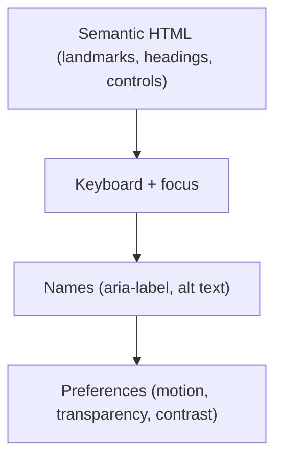

# 73 · Accessibility

> [!abstract] In one line
> Accessible-by-default means **semantic HTML first**, then focus states, labels,
> and respecting user preferences — most of which static Astro gives you cheaply.

## Mental model



Fix issues top-down: getting the HTML right removes most ARIA needs. "No ARIA is
better than bad ARIA."

## The checklist that pays off

**Landmarks & structure**
- One `<header>` (banner), one `<main>`, one `<footer>`, labelled `<nav>`.
- A single `<h1>` per page; headings in order (no skipping levels).
- This repo: `<main id="main">` and a labelled `<nav aria-label="Primary">`.

**Skip link** — first focusable element jumps past the nav:

```astro
<a href="#main" class="sr-only focus:not-sr-only …">Skip to content</a>
```

`sr-only` + `focus:not-sr-only` keeps it invisible until focused. Already in
`src/layouts/main.astro`.

**Focus visibility** — never remove outlines without a replacement. This repo uses
`focus-visible:ring-3 focus-visible:ring-ring/50` on interactive elements.

**Current state** — `aria-current="page"` on the active nav link (this repo does it
in `Header.astro`), not just a colour change.

**Icon buttons need names** — a glyph-only control is invisible to screen readers:

```astro
<Button aria-label={`Change theme, currently ${current.label.toLowerCase()}`} />
```

**Images need `alt`** — meaningful text, or `alt=""` for decorative
([[63-images-assets]]).

## Respecting preferences

This repo's global stylesheet neutralises motion for users who ask:

```css
@media (prefers-reduced-motion: reduce) {
  *, ::before, ::after {
    animation-duration: 0.01ms !important;
    transition-duration: 0.01ms !important;
    scroll-behavior: auto !important;
  }
}
```

And the translucent header falls back to opaque when transparency is unwanted:

```css
@media (prefers-reduced-transparency: reduce) {
  .site-header { background-color: var(--background); backdrop-filter: none; }
}
```

Both are tiny and both are real ([[33-design-tokens-theming]]).

## Keyboard & interaction

- Everything interactive is reachable and operable by keyboard (real `<button>`,
  `<a>`, not `<div onclick>`).
- The mobile menu traps/returns focus and closes on `Escape`.
- Colour contrast meets WCAG AA **in both themes** — check `muted-foreground` on
  `background` in light *and* dark ([[33-design-tokens-theming]]).
- `scroll-padding-top` ensures anchor targets aren't hidden under the sticky header.

## Gotchas

> [!warning] Islands can break semantics
> A framework component might render a `<div>` where a `<button>` belongs
> ([[23-framework-integration]]). You ship HTML, so *you* own the semantics — check
> the rendered output, not just the JSX.

> [!warning] No-JS must still work
> Your islands' HTML is server-rendered ([[21-islands]]), so core content and links
> work without JS. Don't gate essential content behind hydration.

> [!warning] Colour alone conveys nothing
> Active nav has an underline (`after:bg-primary`), not only a colour shift. Hover
> without focus styles is half-done.

> [!warning] Motion preferences are not optional
> Autoplaying, unavoidable animation is a real problem for some users. The override
> above is the cheap, correct default.

> [!warning] Test with the keyboard and a screen reader
> Tab through the site. Does the skip link appear? Is focus visible? Is the theme
> toggle announced with its current value? Ten minutes finds what linters miss.

## Exercise

- [ ] Tab through this repo's pages. List every control without a visible focus
      ring, and every icon-only control without a name.
- [ ] Toggle `prefers-reduced-motion` in devtools and confirm the override applies.
- [ ] Check `text-muted-foreground` contrast against `bg-background` in both themes
      and note any pair that fails AA.
- [ ] Read the rendered HTML of an island and verify a control is a real `<button>`.

> [!question]- Why is static Astro a good a11y starting point?
> Because it ships semantic HTML and works without JavaScript by default. Most
> accessibility failures come from JS-only rendering and hand-rolled controls —
> Astro's defaults push you away from both.

## Further reading
- MDN — *Accessibility* <https://developer.mozilla.org/en-US/docs/Web/Accessibility>
- WCAG 2.2 quick reference <https://www.w3.org/WAI/WCAG22/quickref/>

Prev: [[72-testing]] · Next: [[74-performance-budgets]] · Index: [[00-index]]
