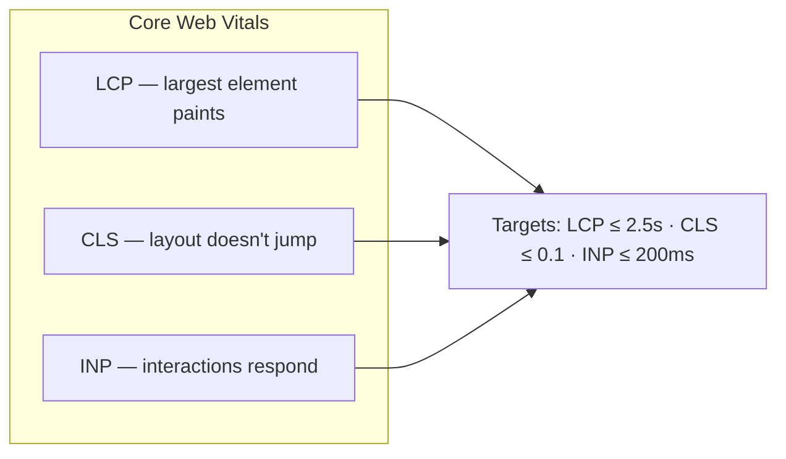

# 74 · Performance Budgets

> [!abstract] In one line
> Set numeric limits (LCP, CLS, INP, JS size) and let Astro's defaults keep you
> inside them — then measure, don't guess.

## Mental model



A budget is a number you refuse to cross. Without one, "it feels fast" drifts into
"why is this 800 kB of JS?".

## What moves each metric — and Astro's lever

| Metric | Main cause | Astro lever |
|---|---|---|
| **LCP** | slow biggest element (hero image, font, blocking JS) | static HTML by default; `<Image>` sizing; font preload + `swap` ([[63-images-assets]], [[64-fonts]]) |
| **CLS** | images/embeds without dimensions; late font swap | width/height on images; `font-display: swap` with matched metrics; reserve space |
| **INP** | heavy or late JavaScript | zero JS by default; fewer/smaller islands; `client:visible`/`idle` ([[22-hydration-directives]]) |

> [!tip] Astro's default *is* the budget maker
> Ship HTML, add JS per island, size your images, preload one font. Do only that and
> you're usually inside the targets without tuning.

## A starter budget

```
JS on a content page     < 50 kB (gzipped)
LCP                      ≤ 2.5 s (mobile, throttled)
CLS                      ≤ 0.1
INP                      ≤ 200 ms
Lighthouse perf          ≥ 95 on content pages
```

Write it down where the team sees it. A budget nobody reads is a wish.

## Measuring

```bash
bun run build          # build the static output
bun run preview        # serve dist/ locally
# then run Lighthouse against the preview URL
```

- **Lighthouse / PageSpeed Insights** — lab metrics, good for regressions.
- **CrUX / Web Vitals field data** — what real users got; the truth.
- **Bundle inspection** — `dist/_astro/*.js` shows exactly which islands cost what.

## This repo's baseline (by construction)

- **Static output** → nothing renders on a request ([[81-build-output]]).
- **Two islands**, both `client:idle` → minimal JS, deferred
  ([[25-when-not-to-hydrate]]).
- **Fonts preloaded** with `?url` + `swap` → no invisible-text flash
  ([[64-fonts]]).
- **Theme applied pre-paint** by an inline script → no dark-mode flash
  ([[25-when-not-to-hydrate]]).
- **All URLs canonical via one helper** → no redirect chains ([[15-feeds-sitemap-seo]]).

Each of those is a performance decision, not an accident.

## Gotchas

> [!warning] Lab ≠ field
> A perfect Lighthouse score on your laptop says little about a mid-range phone on
> 4G. Use field data (or throttled lab runs) for judgment.

> [!warning] One heavy island can dominate
> A single rich island can ship more JS than the rest of the site combined. Inspect
> `dist/_astro/` and know what each island costs ([[72-testing]] for a "grep the
> build" gate).

> [!warning] Analytics and third parties bypass your budget
> A tag manager or chat widget can wreck INP and CLS more than any framework choice.
> Treat third-party scripts as budget items.

> [!warning] Don't optimise the number, optimise the page
> Chasing a metric can produce worse UX (removing focus rings, hiding content).
> The metrics are proxies; the goal is a page that loads and responds.

## Exercise

- [ ] Run Lighthouse against `bun run preview`. Record LCP/CLS/INP and compare to the
      starter budget.
- [ ] List every JS file in `dist/_astro/` and attribute each to an island. Is any
      surprise large?
- [ ] Add a `client:load` to a second island and re-measure. How much did you spend?
- [ ] Pick one budget line and find the single Astro change most likely to breach it.

> [!question]- Why "budget" instead of "when it's slow, fix it"?
> Because performance only ever degrades incrementally — one widget, one font, one
> script at a time. A budget makes the cost visible *at the moment* you add it, when
> it's cheap to say no.

## Further reading
- web.dev — *Core Web Vitals* <https://web.dev/articles/vitals>
- Astro — *Performance notes* <https://docs.astro.build/en/concepts/why-astro/#fast-by-default>

Prev: [[73-accessibility]] · Next: [[81-build-output]] · Index: [[00-index]]
