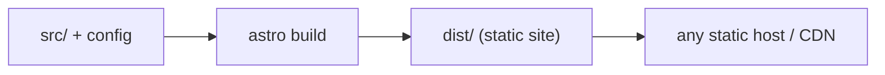

# 81 · Build Output

> [!abstract] In one line
> `astro build` turns your project into `dist/` — plain, static, deployable files
> with hashed asset names.

## Mental model



`dist/` is the **product**. Everything else is source. It's disposable: delete it,
rebuild, get a byte-similar result.

## What's actually in `dist/` (this repo)

```
dist/
├── index.html              # /
├── 404.html                # GH Pages serves this for missing paths
├── about/index.html        # /about/
├── blog/
│   ├── index.html
│   ├── rss.xml             # the feed endpoint, prerendered
│   ├── tags/<tag>/index.html
│   └── <slug>/index.html   # one per post
├── contact/index.html
├── projects/
│   └── <slug>/index.html
├── _astro/                 # hashed assets
│   ├── main.<hash>.css
│   ├── ThemeToggle.<hash>.js
│   ├── MobileNav.<hash>.js
│   ├── inter-latin-wght-normal.<hash>.woff2
│   └── jetbrains-mono-latin-wght-normal.<hash>.woff2
├── favicon.svg             # copied from public/
├── og.png                  # copied from public/
├── robots.txt              # prerendered endpoint
├── rss.xml                 # re-exported feed
├── sitemap-0.xml
└── sitemap-index.xml
```

26 HTML pages total. Note the shape: **routes are directories with `index.html`**
(trailing-slash URLs), which is what most static hosts expect.

## The `_astro/` directory

Everything *processed* by the build lands here with a **content hash** in the name:
CSS, island JS, images, and fonts. The hash is the cache-busting strategy —
`main.CRJbZTn9.css` changing means the bytes changed, so hosts can cache forever
([[63-images-assets]], [[64-fonts]]).

Notice which JS exists: `ThemeToggle` and `MobileNav` (the two islands) plus their
shared runtime (`react-dom`, `client`, `useOpenInteractionType`). **Nothing else** —
that's the zero-JS default made visible ([[21-islands]]).

## Not in `dist/`

- `.astro/` — generated **types** (`content.d.ts`, `types.d.ts`, `collections/`),
  used by `astro check`, not shipped ([[71-typescript]]).
- `src/`, `public/` (copied *into* dist, but the originals aren't there), config.
- Server code — a pure static build has none ([[51-ssg-ssr-hybrid]]).

## Inspecting and previewing a build

```bash
bun run build       # writes dist/
bun run preview     # serves dist/ locally, base-aware
```

Because the output is static, you can also serve it with anything:
`python -m http.server`, `npx serve`, or point a CDN at the folder.

> [!warning] `dist/` is generated — never edit it
> Edits vanish on the next build. Fix the source. It's also gitignored: don't commit
> build output.

> [!tip] Grep the build as a cheap test
> `grep` assertions against `dist/` are fast, dependency-free checks
> ([[72-testing]]). Example: confirm no `learning/` leaked:
> `test ! -e dist/learning`.

> [!warning] Base path shows up in output
> With `base: "/site"`, internal links in the HTML already include `/site`. Deploy
> `dist/` to the right place or they 404 ([[82-hosting-adapters]]).

## Gotchas

> [!warning] Trailing-slash routing
> Output uses `foo/index.html`, served at `/foo/`. If a host is configured for
> extensionless/no-slash URLs, links and canonical tags can mismatch — keep the
> site's trailing-slash intent consistent ([[04-routing]], [[15-feeds-sitemap-seo]]).

> [!warning] Stale `dist/`
> Always rebuild before deploying. CI does this for you ([[83-ci-cd]]); manual
> uploads of an old `dist/` are the classic "why isn't my change live".

> [!warning] Big `dist` ≠ slow site
> A large `dist/` (many pages, images) is fine — what ships per page is what
> matters. Check what a *single page* references ([[74-performance-budgets]]).

## Exercise

- [ ] Run `bun run build` and list every JS file in `dist/_astro/`. Attribute each
      to an island or shared runtime.
- [ ] Open `dist/index.html` and find a link — confirm it already contains `/site`.
- [ ] Add a temporary file `public/test.txt`, rebuild, and find it in `dist/`.
      Delete it.
- [ ] Explain why `dist/blog/rss.xml` exists *and* `dist/rss.xml` exists.

> [!question]- Why hashed filenames instead of query strings?
> Hashes survive CDNs and proxies that ignore query strings, and they let you set
> `Cache-Control: immutable` for a year. The name *is* the version.

## Further reading
- Astro — *Build & preview CLI* <https://docs.astro.build/en/reference/cli-reference/>
- Astro — *Deploy overview* <https://docs.astro.build/en/guides/deploy/>

Prev: [[74-performance-budgets]] · Next: [[82-hosting-adapters]] · Index: [[00-index]]
