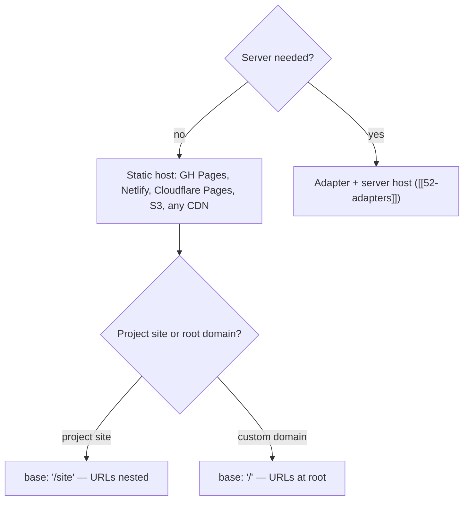

# 82 · Hosting

> [!abstract] In one line
> A static Astro build deploys as files to any host — the work is picking the
> **base path** and getting **`site`/`base`** to agree with where it's served.

## Mental model



Two knobs decide everything: **`site`** (origin) and **`base`** (path prefix).

## How it works

```js
// astro.config.mjs (this repo)
export default defineConfig({
  site: "https://ashik-maybe.github.io",
  base: "/site",       // because it's a GitHub Pages *project* site
})
```

- **`site`** feeds canonical URLs, RSS, sitemap ([[15-feeds-sitemap-seo]]).
- **`base`** prefixes every internal URL; all links must go through it — this repo
  centralises that in one URL helper ([[02-project-structure]], [[04-routing]]).

## Project site vs custom domain

| | Project site (`user.github.io/site/`) | Custom domain (`example.com`) |
|---|---|---|
| `base` | `"/site"` | `"/"` (default) |
| URLs | nested under `/site/` | at root |
| `robots.txt` | served at `/site/robots.txt` → **inert** | served at `/robots.txt` → works |
| Authority | weaker (subpath of a shared origin) | stronger |

That `robots.txt` row is the trap: crawlers only read the origin root. This repo
documents that its `robots.txt` is present-but-inert on Pages rather than pretending
otherwise ([[15-feeds-sitemap-seo]]). Moving to a custom domain fixes it.

## Static-host options

| Host | Notes |
|---|---|
| **GitHub Pages** | free; project sites need `base`; deploy via Actions ([[83-ci-cd]]) |
| **Netlify / Cloudflare Pages** | build from repo; easy redirects/headers; custom domains |
| **S3 / GCS + CDN** | you configure caching and the index/404 mapping yourself |
| **any static server** | `dist/` is just files |

## Caching and headers

Hashed assets (`_astro/*.<hash>.*`) can be cached `immutable` for a long time. The
HTML should be short-lived (it changes per deploy). Some hosts read a `_headers`/
`netlify.toml`/`vercel.json`; GitHub Pages gives you very little control here.

## Gotchas

> [!warning] `base` and links must never disagree
> One hardcoded `/blog` on a `/site` deploy is a 404. The single-URL-helper rule is
> what makes the base safe to change ([[15-feeds-sitemap-seo]]).

> [!warning] Switching to a custom domain isn't just DNS
> Update `site` (and usually `base`), rebuild, redeploy, and re-submit sitemaps. Any
> absolute URL baked at build time changes ([[15-feeds-sitemap-seo]]).

> [!warning] Don't index placeholder content
> This repo's launch guide says: replace placeholders first, decide the domain,
> *then* submit to search engines. Optionally `noindex` until real content lands
> ([[74-performance-budgets]] aside — indexing bad content costs you).

> [!warning] 404 handling differs per host
> GitHub Pages serves `404.html`; some hosts want a `_redirects` or a catch-all.
> Astro's `404.astro` gives you the page; the host maps it ([[81-build-output]]).

## Exercise

- [ ] Read this repo's `site` and `base`. Describe the exact URL the blog index is
      served at.
- [ ] If you switched to `https://example.com`, list every line/config you'd change.
- [ ] Explain why `/site/robots.txt` can't control crawling but `/robots.txt` can.
- [ ] Check `docs/agent/launch.md` for the domain decision and summarize what's
      pending before this site should be indexed.

> [!question]- Why doesn't Astro just write absolute URLs everywhere?
> Because the same source should be deployable to different bases. Keeping URLs
> relative-to-base and building them in one place means changing hosts is a config
> change, not a find-and-replace ([[15-feeds-sitemap-seo]]).

## Further reading
- Astro — *Deploy to GitHub Pages* <https://docs.astro.build/en/guides/deploy/github/>
- Astro — *Configuration: `base`* <https://docs.astro.build/en/reference/configuration-reference/#base>

Prev: [[81-build-output]] · Next: [[83-ci-cd]] · Index: [[00-index]]
