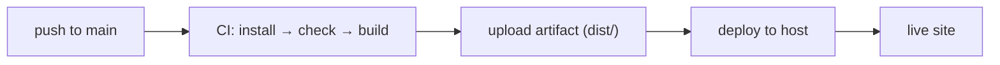

# 83 · CI/CD

> [!abstract] In one line
> On every push, CI installs, builds, and ships `dist/` — so no one ever deploys
> from their laptop by hand.

## Mental model



Two halves: **continuous integration** (prove it builds/typechecks) and
**continuous deployment** (publish the artifact). Keep them separate so a broken
build never deploys.

## This repo's workflow

`.github/workflows/deploy.yml` deploys to GitHub Pages:

```yaml
name: Deploy to GitHub Pages
on:
  push:
    branches: [ main ]
  workflow_dispatch:

permissions:
  contents: read
  pages: write
  id-token: write

jobs:
  build:
    runs-on: ubuntu-latest
    steps:
      - uses: actions/checkout@v7
      - uses: withastro/action@v6

  deploy:
    needs: build
    runs-on: ubuntu-latest
    environment:
      name: github-pages
      url: ${{ steps.deployment.outputs.page_url }}
    steps:
      - id: deployment
        uses: actions/deploy-pages@v5
```

Key points:
- **`withastro/action@v6`** detects your package manager from the lockfile, installs,
  runs `build`, and uploads the artifact — one step for the whole build story.
- **`permissions`** are the minimum Pages needs (`pages: write`, `id-token: write`);
  `contents: read` to check out.
- **`deploy` runs `needs: build`** — it can't publish unless the build job passed.

## The gap: add type-checking

`withastro/action` builds, but it doesn't run `astro check`
([[71-typescript]]). To make CI fail on type errors, add a step *before* the build:

```yaml
      - uses: actions/setup-node@v5
        with: { node-version: 24, cache: npm }   # or bun
      - run: npm ci
      - run: npx astro check        # gate
      - uses: withastro/action@v6   # then build + upload
```

Or run checks in a separate job so the build stays fast and the gate is explicit.

> [!warning] Astro 7 — match action majors to your toolchain
> `checkout@v7`, `withastro/action@v6`, `deploy-pages@v5`, Node `>= 22.12`
> ([[71-typescript]] pins TS 6 / Node engines). Mismatched action versions are the
> usual cause of a "mysterious CI failure that works locally".

## Secrets and environment

- Public build vars ([[66-env-config]]) can go in the step:
  ```yaml
  env:
    PUBLIC_SITE_URL: 'https://example.com'
  ```
- **Secrets** (`API_KEY`, tokens) belong in repo/environment **secrets**, referenced
  as `${{ secrets.API_KEY }}` — never committed. Remember: a *static* build bakes
  what it reads ([[06-rendering-model]]), so don't feed secrets to a static build.

## Preview deployments

For PR previews, a host like Netlify/Vercel/Cloudflare Pages builds each PR to a
preview URL automatically. On GitHub Pages you deploy one site per repo, so previews
usually mean a second host or a subpath — decide deliberately ([[82-hosting-adapters]]).

## Gotchas

> [!warning] CI must use the same package manager as local
> This repo uses Bun locally; the lockfile decides CI. Keep one lockfile
> (`bun.lock`/`package-lock.json`) and don't mix — a missing lockfile makes CI pick
> a different resolver and drift.

> [!warning] Cache the right thing
> Cache the package manager's store (via `cache:`), not `node_modules` across
> unrelated runs. Reproducible installs come from the lockfile, not a cache.

> [!warning] Deploy only from `main` (or tags)
> Every-branch deploys mean half-finished work goes live. Gate deployment on the
> branch, and require checks before merge.

> [!warning] A green build isn't a correct site
> CI proves it *builds*, not that it's right. Add the cheap gates you trust
> (type-check, a grep assertion on `dist/`, a smoke test) so "green" means something
> ([[72-testing]]).

## Exercise

- [ ] Run `astro check` locally, then add the check step above and explain what new
      failure class CI would now catch.
- [ ] List the three `permissions` in the workflow and what breaks if you remove each.
- [ ] Decide where a future `API_KEY` should live (repo secret vs build env) given a
      *static* deploy, and why.
- [ ] Describe what a PR preview would need that this Pages workflow doesn't provide.

> [!question]- Why separate `build` and `deploy` jobs?
> So the artifact is produced once and published only if it passed — and so deploy
> can be re-run or gated (environment protection, approvals) independently of the
> build. It's the "prove, then publish" split.

## Further reading
- Astro — *Deploy to GitHub Pages* <https://docs.astro.build/en/guides/deploy/github/>
- `withastro/action` <https://github.com/withastro/action>

Prev: [[82-hosting-adapters]] · Next: [[91-starlight]] · Index: [[00-index]]
