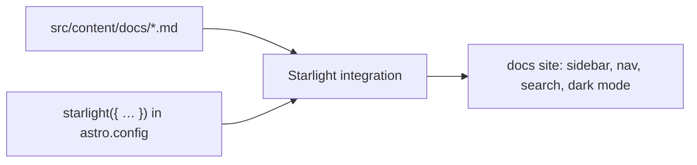

# 91 · Starlight

> [!abstract] In one line
> Starlight is an official Astro *docs theme*: content collections, sidebar,
> search, i18n, and theming — pre-built, so you write docs, not layout code.

## Mental model



It's just an Astro integration ([[92-integrations]]) plus a content convention. You
get the whole docs apparatus by installing one package.

## How it works

```js
// astro.config.mjs
import starlight from "@astrojs/starlight"

export default defineConfig({
  integrations: [
    starlight({
      title: "My Docs",
      social: [{ icon: "github", label: "GitHub", href: "…" }],
      sidebar: [
        { label: "Guides", items: ["guides/start", "guides/deploy"] },
        { label: "Reference", autogenerate: { directory: "reference" } },
      ],
    }),
  ],
})
```

Content lives in `src/content/docs/`:

```md
---
title: Getting started
description: Install and run.
---

Docs go here. Markdown, MDX, callouts, code blocks — all supported.
```

## What you get out of the box

- **Sidebar + nav** driven by config (or `autogenerate`).
- **Search** (built-in, via Pagefind).
- **Dark mode**, responsive layout, accessible defaults.
- **i18n** — per-locale content and UI strings ([[65-i18n]]).
- **MDX**, Expressive-Code-style blocks, admonitions/callouts ([[34-code-blocks-expressive-code]]).

## When to use it — and when not to

| Use Starlight | Hand-roll (like this repo's blog) |
|---|---|
| Documentation, handbooks, API references | A portfolio, blog, or marketing site |
| You want sidebar/search/i18n now | You want full control of every pixel |
| Content is a *manual* | Content is *articles* |

This repo is the "hand-roll" case: it builds its own layout, blog, and MOC because
the site's shape is personal, not a manual. Starlight would be overkill — and would
impose its structure on a portfolio.

> [!tip] You can live in both worlds
> A common setup: Starlight at `/docs` and a custom Astro site at the root, in one
> project. They're just different route trees over the same build
> ([[04-routing]]).

> [!warning] Ecosystem — expect version drift
> Starlight is a fast-moving integration. Pin its major to your Astro major and read
> *its* changelog; config keys (`sidebar`, `social`, plugin API) have changed between
> majors. Don't assume a two-year-old snippet is current.

## Gotchas

> [!warning] Starlight owns `src/content/docs/`
> Its collections are its own; don't mix them with your blog collections
> ([[11-content-collections]]) unless you mean to.

> [!warning] Theming is via CSS variables, not forking
> Override its tokens rather than editing its components — upgrades stay painless
> ([[33-design-tokens-theming]]).

> [!warning] It's still a static build by default
> Exactly like any Astro site: `dist/` of HTML + hashed assets
> ([[81-build-output]]). No server needed unless you add one.

## Exercise

- [ ] Sketch a Starlight sidebar for a 3-section manual using `autogenerate`.
- [ ] Decide, for a hypothetical "Astro handbook", whether Starlight or this repo's
      hand-built blog fits better, and why.
- [ ] Name one thing Starlight gives you free that this repo implemented by hand.

> [!question]- Why does Starlight exist at all, if Astro already does content?
> Because docs sites share a very specific, repetitive structure (sidebar, search,
> versioned nav, i18n). Starlight packages that consensus so you don't rebuild it —
> while staying an ordinary Astro integration underneath.

## Further reading
- Starlight docs <https://starlight.astro.build/>

Prev: [[83-ci-cd]] · Next: [[92-integrations]] · Index: [[00-index]]
