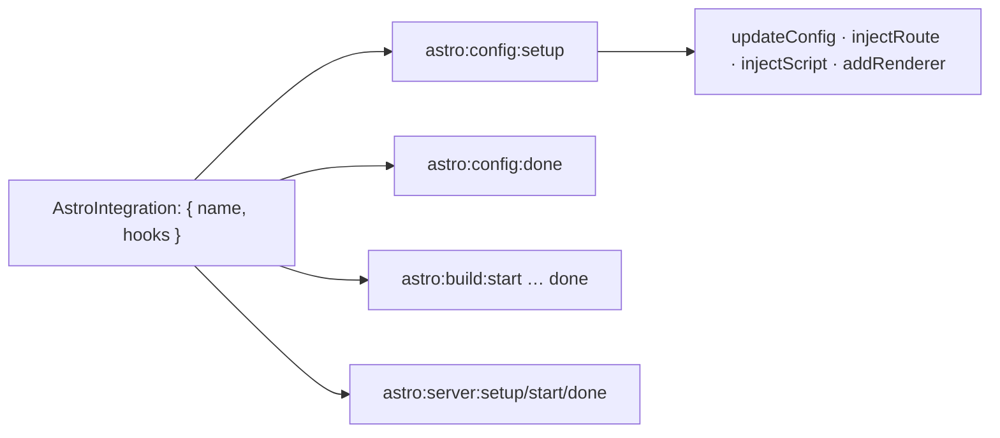

# 92 · Integrations

> [!abstract] In one line
> An integration is a plugin with **lifecycle hooks** into Astro's config, server,
> and build — that's how Tailwind, React, sitemap, and Starlight all attach.

## Mental model



An integration is a plain object: a `name` and a `hooks` map. Astro calls the hooks
at defined points; each hook can mutate config, add routes, or hook the build.

## How it works

```js
// a minimal integration
/** @type {import('astro').AstroIntegration} */
export default {
  name: "my-integration",
  hooks: {
    "astro:config:setup": ({ updateConfig, injectRoute, injectScript, addRenderer }) => {
      updateConfig({ vite: { plugins: [myVitePlugin()] } })
      injectRoute({ pattern: "/health", entrypoint: "./src/health.ts" })
      injectScript("page", `console.log("injected on every page")`)
    },
    "astro:build:done": ({ dir, logger }) => {
      logger.info(`build wrote to ${dir}`)
    },
  },
}
```

Register it:

```js
// astro.config.mjs
import myIntegration from "./my-integration.js"
export default defineConfig({ integrations: [myIntegration()] })
```

## The hooks that matter

| Hook | Runs… | Use for |
|---|---|---|
| `astro:config:setup` | while config resolves | `updateConfig`, `injectRoute`, `injectScript`, `addRenderer` |
| `astro:config:done` | config final | read the resolved config |
| `astro:server:setup` / `start` / `done` | dev server lifecycle | dev middleware, websockets |
| `astro:build:start` / `setup` / `generated` / `ssr` / `done` | build lifecycle | generate files, post-process `dist/` |
| `astro:route:setup` / `astro:routes:resolved` | per-route / after routes known | tweak route options |

## Capabilities you'll see used

- **`updateConfig`** — add Vite plugins, markdown options, image settings, or other
  integrations.
- **`injectRoute`** — add a route the user didn't write (how adapters expose their
  endpoints).
- **`injectScript`** — add a client script to pages, with a stage (`head-inline`,
  `page`, `page-ssr`).
- **`addRenderer`** — register a UI framework renderer (what `@astrojs/react` does).
- **`astro add <name>`** — CLI that installs and wires an official integration.

## This repo's integrations

- `@astrojs/react` — via `addRenderer` ([[23-framework-integration]]).
- `@tailwindcss/vite` — a **Vite plugin**, added through `vite.plugins`, not
  `integrations` ([[32-tailwind-v4]]).
- `astro-expressive-code` — hooks the markdown pipeline ([[34-code-blocks-expressive-code]]).
- `@astrojs/sitemap` — injects a build step that writes the sitemap
  ([[15-feeds-sitemap-seo]]).

That spread is the lesson: some things are integrations, some are Vite plugins, some
are markdown options. Know which layer you're touching.

## Gotchas

> [!warning] Integration **order matters**
> Expressive Code must run before MDX to intercept fences; some integrations mutate
> config others read. If something "isn't applied", check ordering first.

> [!warning] Integrations can add surprising weight
> A one-line integration can pull in a renderer, a bundler plugin, and a runtime.
> Read what it injects; don't stack them "just in case" ([[74-performance-budgets]]).

> [!warning] `astro add` edits config, not your source
> It installs and registers the integration. Wiring it into components is still your
> job.

> [!warning] Version-align every `@astrojs/*`
> Integrations track Astro's major. A mismatched pair is the most common cause of
> cryptic build failures — upgrade them together ([[83-ci-cd]]).

## Exercise

- [ ] Open `astro.config.mjs` and classify each entry as *integration*, *Vite
      plugin*, or *config option*.
- [ ] Write a throwaway integration whose `astro:build:done` logs `"build done"`, and
      run `bun run build` to see it.
- [ ] Use `injectRoute` to add a `/version` endpoint from a scratch integration, then
      explain how it differs from writing the file in `src/pages/` ([[41-endpoints]]).

> [!question]- Why hooks instead of subclassing?
> Hooks are a flat, ordered list of named lifecycle points — easy to compose, easy to
> reason about, no inheritance. Integrations stay small objects and Astro stays in
> control of *when* things happen.

## Further reading
- Astro — *Integrations API* <https://docs.astro.build/en/reference/integrations-reference/>

Prev: [[91-starlight]] · Next: [[93-astro-vs-next-vs-sveltekit]] · Index: [[00-index]]
