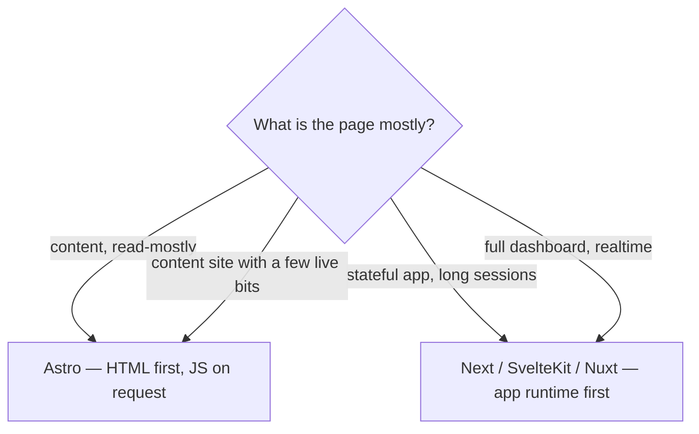

# 93 · Astro vs Next vs SvelteKit

> [!abstract] In one line
> All three can build almost anything; they differ in **what they do by default**,
> and defaults are what you live with every day.

## Mental model

The honest answer is "it depends" — but the *default* tells you who the framework
was built for ([[01-why-astro]]).

## The comparison

| | Astro | Next.js | SvelteKit |
|---|---|---|---|
| Default output | static HTML, 0 JS | app runtime (JS) | app runtime (JS) |
| Add JS by | opting **in** per island | default; opt out | default; opt out |
| UI language | any (React/Vue/Svelte/Solid/…) | React | Svelte |
| Data/routing | pages + content collections | React Server Components + routes | routes + load functions |
| SSR/adapters | yes, opt-in | yes, first-class | yes, first-class |
| Sweet spot | content, docs, blogs, marketing | apps, dashboards, RSC-heavy products | lean interactive apps, great DX |
| Mental unit | a **page** | a **component tree** | a **route + component** |

## Where each genuinely wins

**Astro**
- Content-heavy sites where performance *is* the product.
- Mixed stacks (React island + Vue island + static HTML) without committing to one.
- "Just a website" that a JS framework would bloat.

**Next.js**
- Products that are apps: auth, dashboards, lots of client state.
- Teams standardised on React across web and (with RN) mobile.
- Heavy use of React Server Components / streaming app patterns.

**SvelteKit**
- Interactive apps with a premium on small bundles and developer ergonomics.
- Teams who love Svelte's compiler model.

## The overlap (be honest)

Astro *can* do SSR, actions, sessions, APIs ([[51-ssg-ssr-hybrid]], [[41-endpoints]], [[44-actions]]). Next
*can* build a static blog. SvelteKit *can* be static. The differences are **defaults,
ecosystem, and team**, not hard capability.

> [!tip] The decision question
> "Is this **mostly content a visitor reads**, or **state that a user manipulates**?"
> Content → Astro. State → an app framework. Mixed → Astro with islands, until the
> app part dwarfs the content part.

## Moving between them

- **Next → Astro**: pages become `.astro`; React components stay, but *only* the
  interactive ones become islands ([[21-islands]]). Most of your JS disappears.
- **Astro → Next**: the reverse — islands become the whole tree, and the zero-JS
  default is something you re-earn per route.

## Gotchas

> [!warning] Don't pick by benchmark alone
> A framework that ships no JS wins JS benchmarks trivially. Pick by *shape of work*,
> then verify with your own metrics ([[74-performance-budgets]]).

> [!warning] "Can it do X?" is the wrong question
> Every modern framework can. Ask "how much do I fight the grain to do X?" Astro
> fights you on a realtime dashboard; Next fights you on a static brochure site.

> [!warning] Migration cost is mostly components
> Route files and data loading differ, but the bulk is UI. Frameworks Astro supports
> natively (React) migrate more cheaply than ones it doesn't.

## Exercise

- [ ] Classify five pages — portfolio, blog post, contact form, live chat dashboard,
      pricing — as Astro-shaped or app-shaped, with one reason each.
- [ ] Name a page you'd build in Next that you *wouldn't* build in Astro, and vice
      versa, from your own experience.
- [ ] For this repo, state the single sentence that justifies Astro over Next.

> [!question]- Is there a wrong choice here?
> Rarely wrong — often suboptimal. A static brochure in Next is heavy; a realtime
> dashboard in Astro is a fight. Fit the default to the work.

## Further reading
- Astro — *Why Astro* <https://docs.astro.build/en/concepts/why-astro/>

Prev: [[92-integrations]] · Next: [[94-limits]] · Index: [[00-index]]
