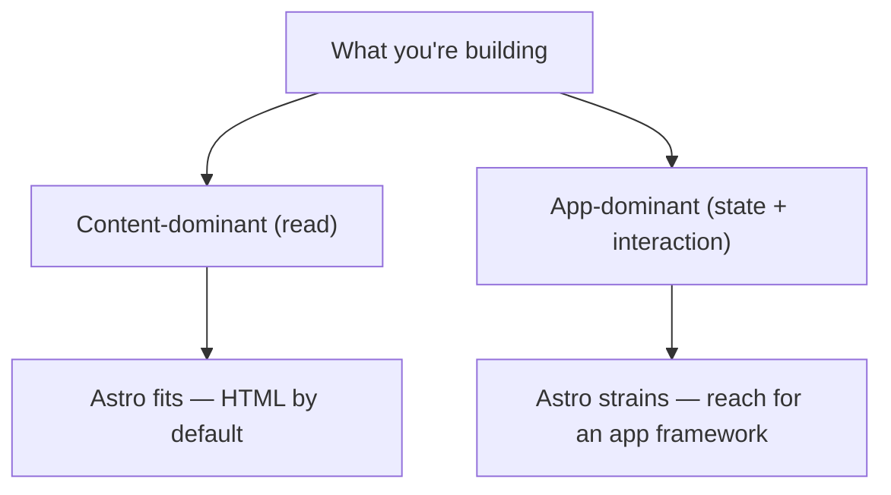

# 94 · Limits

> [!abstract] In one line
> Astro is the wrong tool when the page is an **app** — long-lived, deeply
> interactive, stateful — and you'd be fighting the grain to force it.

## Mental model

The framework optimises for **shipping HTML and adding JS surgically**
([[01-why-astro]], [[21-islands]]). Everything below is where that optimisation stops
paying off.

## Where Astro strains

1. **Deeply stateful, long-lived UIs** — dashboards, editors, realtime collaboration.
   You end up with one giant island, and at that point you've just built an SPA with
   extra steps. Use an app framework whose default is the app.
2. **Cross-island state** — islands are separate roots ([[21-islands]]). Sharing
   state between many of them means a store library or moving to a single island.
3. **Heavy client routing** — client-side navigation, optimistic updates, complex
   forms. `ClientRouter` helps navigation ([[61-view-transitions]]) but isn't a
   full client router.
4. **Realtime** — websockets, presence, live cursors. Possible (an island can do it),
   but not what Astro optimises for.

## The escape hatches (before you leave)

Astro is more capable than its reputation suggests — try these first:

| Need | Astro tool |
|---|---|
| Per-request logic | SSR + middleware ([[51-ssg-ssr-hybrid]], [[53-middleware]]) |
| Mutations | actions ([[44-actions]]) |
| Auth/state | sessions + cookies ([[45-sessions-cookies]]) |
| Dynamic in a static page | server islands ([[54-server-islands-partials]]) |
| One rich widget | a single framework island ([[23-framework-integration]]) |
| Live data | client island + fetch, or SSR caching ([[42-external-apis]]) |

> [!tip] The one-island escape
> If exactly one part of the page is app-like, ship **one** island for it and keep
> everything else static. Astro only fails when the *whole page* is that island.

## Signals it's time to switch

- Most of your page is inside `client:*` components.
- You're shipping a routing/state library to make islands cooperate.
- The content is incidental; the interaction is the product.
- Your bundle is dominated by framework runtime, not your code.

If several are true, an app framework ([[93-astro-vs-next-vs-sveltekit]]) is the
honest choice.

## Gotchas

> [!warning] "Astro can't do apps" is false — and unhelpful
> It *can*. The question is cost. Astro has SSR, actions, sessions, middleware. You
> leave not because it's impossible but because the defaults stop helping.

> [!warning] Don't split a single app across frameworks
> A dashboard half in islands and half in an SPA is the worst of both. Pick the
> app-shaped thing and own it in one framework.

> [!warning] Islands have serialization limits
> Props cross a boundary as data ([[24-props-data-across-boundaries]]). If your
> design needs functions or rich objects between "components", the island model is
> the wrong shape.

> [!warning] Static has no runtime secrets
> A static site can't hold secrets or accept writes ([[43-data-persistence]]). If you
> need those, you need a server — Astro can, but design for it deliberately.

## Exercise

- [ ] List three product types where you'd *not* choose Astro, with the load-bearing
      reason for each.
- [ ] Take one of them and argue how far Astro's escape hatches get you before you'd
      switch.
- [ ] For this repo, name the feature that would finally push you to an app
      framework, and how much of the site it would consume.

> [!question]- Does "Astro has limits" contradict "build anything Astro supports"?
> No — it's the same idea from the other side. *Everything Astro supports* is a lot:
> content, SSR, APIs, actions, sessions, islands in any framework. The limits are
> about **fit**, not capability: recognise when the app *is* the product, and pick the
> tool whose defaults match it.

## Further reading
- Astro — *Why Astro* (the trade-off framing) <https://docs.astro.build/en/concepts/why-astro/>

Prev: [[93-astro-vs-next-vs-sveltekit]] · Index: [[00-index]] · **End of vault.**
